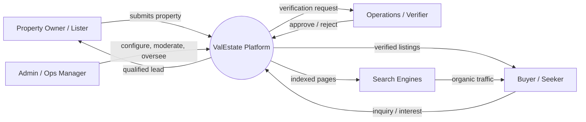
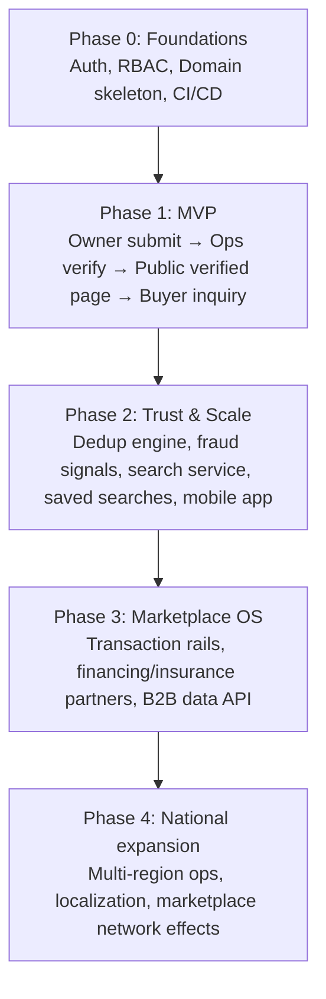

# Document 01 — Product Vision, Strategy & Scope

**Project Codename:** ValEstate
**Document Owner:** Product Lead
**Status:** DRAFT — Awaiting Approval
**Version:** 0.2.0
**Last Updated:** 2026-07-18

---

## 1. Purpose

This document establishes the **strategic foundation** for the ValEstate platform. It defines *what we are building, why it must exist, who it serves, how we win, and how we will measure success*. Every subsequent document (architecture, data model, API contracts, operations playbooks, QA strategy) inherits its terminology, principles, and scope boundaries from this document.

This is the **root node** of the documentation tree. If a decision in a later document conflicts with this one, either this document is amended (with a revision entry) or the later document is corrected.

## 2. Scope

**In scope for this document:**
- Product vision, mission, and long-term north star
- The core differentiator: **Verification-First** trust model
- Strategic pillars and non-negotiable principles
- High-level actors and value exchange
- Business model and monetization thesis (directional)
- Success metrics (North Star + supporting KPIs)
- Product phasing philosophy (MVP → National platform)
- The **master documentation index** and build sequence

**Explicitly out of scope for this document (deferred to named documents):**
- Detailed personas & RBAC roles → *Doc 03*
- Domain model / ubiquitous language → *Doc 04*
- System & deployment architecture → *Doc 05*
- Feature-level functional specs → *Doc 06+*
- Database schema → *Doc 08*
- API contracts → *Doc 09*

## 3. Dependencies

| Dependency | Type | Notes |
|---|---|---|
| Stakeholder alignment on "verification-first" as a hard constraint | Business | This is the platform's core bet; must be confirmed before build |
| Target launch geography (single city/region for MVP) | Business | Drives operations staffing, legal, and SEO strategy — **Open Question OQ-1** |
| Regulatory/compliance context (real estate + PII) | Legal | Jurisdiction-specific; see *Doc 20* |
| Tech stack (fixed by mandate) | Technical | Next.js, RN, Yii2, MySQL, Redis, S3 — see §10 |

## 4. Success Criteria (for this document)

This document is "done" when:
1. Stakeholders approve the **vision statement** and the **verification-first constraint** as non-negotiable.
2. The **North Star Metric** and top-line KPIs are accepted.
3. The **documentation roadmap (§12)** and its build order are approved, unblocking Document 02.
4. All **Open Questions** are either answered or formally deferred with an owner.

---

## 5. Vision, Mission & North Star

### 5.1 Vision (the 10-year bet)
> **To become the operating system for real estate transactions** — the trusted layer through which every property is verified, discovered, negotiated, and transacted.

### 5.2 Mission (what we do now)
> **We make real estate trustworthy** by ensuring every property on ValEstate is verified by a human operations process *before* it becomes publicly visible — eliminating fake, duplicate, and fraudulent listings that plague existing marketplaces.

### 5.3 The Problem We Attack
Incumbent marketplaces (99acres, MagicBricks, Zillow-style aggregators) optimize for **listing volume**, not **listing truth**. This produces:

| Problem | Consequence for buyer | Consequence for platform |
|---|---|---|
| Fake / bait listings | Wasted visits, distrust | High churn, brand erosion |
| Duplicate listings | Same property 6× at different prices | Broker spam, poor UX |
| Stale / already-sold listings | Frustration | Dead inventory |
| Unverified owner identity | Fraud risk | Legal exposure |
| Broker-gated information | Buyer feels trapped | Low NPS |

### 5.4 Our Wedge
**Trust as a product feature.** We deliberately trade *listing quantity* for *listing certainty*. A smaller catalog of 100% verified properties beats a massive catalog of 60% noise. This is defensible because verification is **operationally expensive** — competitors optimized for volume cannot easily reverse their incentive model.

### 5.5 North Star Metric
> **Verified Property Transactions Facilitated** (count of buyer↔owner connections that reach a genuine transaction milestone per month).

Rationale: it captures *trust* (property was verified), *liquidity* (buyers show up), and *value delivered* (a real outcome, not a vanity view count). Views and listings are inputs; transactions are the truth.

---

## 6. Strategic Pillars

| # | Pillar | What it means operationally |
|---|---|---|
| 1 | **Trust First** | No property is public until Operations verifies it. Trust signals are surfaced everywhere. |
| 2 | **Verification First** | Verification is a first-class domain, not an afterthought — it has its own lifecycle, SLAs, tooling, and staffing. |
| 3 | **SEO First** | Public verified pages are server-rendered, structured-data-rich, and built to rank. Organic discovery is the primary acquisition channel. |
| 4 | **Mobile First** | Buyers browse on mobile; owners submit from mobile. Design and performance budgets assume mobile as the default. |
| 5 | **API First** | Every capability is an API before it is a screen. Web, mobile, and admin are clients of the same contracts. |
| 6 | **Modular / DDD** | The system is decomposed into bounded contexts (Identity, Listing, Verification, Discovery, Messaging, etc.) that evolve independently. |
| 7 | **Event-Driven** | State transitions (e.g. `PropertySubmitted`, `PropertyVerified`) emit events that drive async workflows (indexing, notifications, SEO regeneration). |
| 8 | **Secure by Design** | JWT + refresh + RBAC, PII minimization, auditability, least privilege. Security is a requirement, not a phase. |

These pillars are **binding constraints**. Any proposed feature that violates a pillar must be escalated, not silently accepted.

---

## 7. Actors & Value Exchange (High-Level)

> Detailed personas and permission matrices are specified in *Doc 03*. This is the strategic map only.

| Actor | Gives | Gets |
|---|---|---|
| **Owner/Lister** | Property data, proof of ownership, availability | Verified badge, qualified buyers, managed inquiries |
| **Buyer/Seeker** | Intent, contact, engagement | Trustworthy listings, direct-ish communication, no bait |
| **Operations/Verifier** | Human judgment, verification labor | Tooling, queue, SLAs to hit |
| **Admin/Ops Manager** | Configuration, policy, moderation | Control plane, analytics, fraud levers |
| **Search Engines** | Distribution | Structured, fresh, canonical content |

---

## 8. Business Model Thesis (Directional)

> This is a **directional hypothesis** for alignment, not a locked pricing spec. Monetization detail is deferred to a future commercial document (*Doc 21 — Monetization & Billing*, added to roadmap).

Candidate revenue streams, ranked by fit with the trust-first thesis:

| Stream | Fit | Notes |
|---|---|---|
| **Owner listing/verification fee** | High | Aligns incentives — paying owners are serious; funds verification cost |
| **Featured / boosted verified listings** | High | Monetizes visibility *without* compromising verification integrity |
| **Buyer premium (early access, richer filters, saved-search alerts)** | Medium | Must not gate core trust value behind paywall |
| **Transaction facilitation / success fee** | High (long-term) | Directly tied to North Star; requires transaction rails (later phase) |
| **B2B: verified data / API to banks, insurers, developers** | High (long-term) | "OS for real estate" endgame |

**Guardrail:** Monetization must never allow an *unverified* property to reach the public. Money can buy *visibility*, never *trust*.

---

## 9. Success Metrics (Product-Level KPIs)

| Layer | Metric | Why it matters | Target philosophy |
|---|---|---|---|
| **North Star** | Verified transactions facilitated / month | Ultimate value | Growth curve |
| **Trust** | % listings rejected at verification | Proves the filter works | Healthy non-zero |
| **Trust** | Verified-listing fraud/complaint rate | Proves the filter is *right* | Near-zero |
| **Supply** | Verified active listings | Catalog liquidity | Steady growth |
| **Ops efficiency** | Median verification turnaround (submit→decision) | Owner experience + cost | SLA-bound (*Doc 12*) |
| **Demand** | Organic sessions from search | SEO-first working | Compounding |
| **Engagement** | Buyer→Owner qualified inquiries | Liquidity signal | Growth |
| **Quality** | Buyer NPS / trust score | Brand moat | High |
| **Retention** | Returning buyer rate | Habit formation | Growth |

Full analytics event taxonomy → *Doc 15*.

---

## 10. Technology Strategy (Fixed Stack)

| Layer | Technology | Strategic rationale |
|---|---|---|
| Web frontend | Next.js + TypeScript + Tailwind + Shadcn UI | SSR/SSG for SEO-first; typed contracts; fast component velocity |
| Mobile | React Native + TypeScript | Shared TS mental model; single team can support both platforms |
| Backend API | Yii2 REST (PHP) + MySQL | Mature, RBAC-friendly, fast to ship CRUD + workflow; team familiarity |
| Cache / realtime aids | Redis | Sessions, rate limiting, queues, hot reads, geo/search assist |
| Async | Queue Workers | Event-driven workflows (verification, indexing, notifications) |
| Admin | Yii2 | Reuses backend domain + RBAC; ops tooling velocity |
| Storage | AWS S3 | Media (photos, ownership docs) with signed URLs |
| Auth | JWT + Refresh + RBAC | Stateless APIs, multi-client, least-privilege |

> **Architect's note (recommendation, non-blocking):** MySQL full-text/`LIKE` search will not scale to national geo+facet search. We should plan a **search service (OpenSearch/Elasticsearch or Meilisearch)** as a Phase 2 read-model, fed by events. Flagged now so the data model in *Doc 08* is designed to be event-sourced-friendly and not lock us in. Decision deferred to *Doc 05*.

---

## 11. Product Phasing Philosophy

We build so the **MVP launches fast without requiring architectural rewrites**. Bounded contexts and event contracts are designed for the national endgame; only *implementation depth* is phased.

| Phase | Theme | Exit criteria |
|---|---|---|
| **0** | Foundations | Auth, RBAC, event bus, deploy pipeline, one bounded context vertically sliced |
| **1** | MVP loop | A property can go submit → verify → public → inquiry, end to end, in one region |
| **2** | Trust & scale | Duplicate/fraud minimization live; dedicated search; mobile app; saved searches |
| **3** | Marketplace OS | Transaction milestones tracked; first B2B/partner integration |
| **4** | National | Multi-region operations, localized SEO, sustained organic growth |

Detailed epic-level roadmap and sequencing → *Doc 19*.

---

## 12. Master Documentation Index (Build Sequence)

This is the **contract for what we produce and in what order**. Each document is produced one at a time, complete, and approved before the next. Terminology stays consistent across all.

| # | Document | Primary role authoring | Depends on | Status |
|---|---|---|---|---|
| 01 | **Product Vision, Strategy & Scope** *(this doc)* | Product Lead | — | DRAFT |
| 02 | Market & Competitive Analysis | Product / BA | 01 | Pending |
| 03 | Personas, User Roles & RBAC Matrix | Product / UX / Security | 01 | Pending |
| 04 | Domain Model & Ubiquitous Language (DDD) | System Architect | 01, 03 | Pending |
| 05 | System & Solution Architecture | Solution Architect | 04 | Pending |
| 06 | Functional Requirements — Module Map & Standards | BA | 04, 05 | Pending |
| 07 | **Property Lifecycle & Verification Workflow** *(the core)* | BA / Ops / Architect | 04, 06 | Pending |
| 08 | Data Model & Database Architecture | DB Architect | 04, 07 | Pending |
| 09 | API Design & Contract Standards | Backend Architect | 05, 08 | Pending |
| 10 | Authentication, Authorization & Security | Security Consultant | 03, 09 | Pending |
| 11 | SEO Architecture & Content Strategy | UX / Frontend / Product | 05, 07 | Pending |
| 12 | Operations & Verification Playbook (SLAs, tooling) | Ops Consultant | 07 | Pending |
| 13 | Discovery, Search & Recommendation | Product / Architect | 07, 08 | Pending |
| 14 | Messaging & Buyer↔Owner Communication | Product / Architect | 03, 07 | Pending |
| 15 | Analytics, Events & Tracking Taxonomy | Product / Data | 04, 07 | Pending |
| 16 | Web Application UX Spec | UX Designer | 06, 11 | Pending |
| 17 | Mobile Application Spec (React Native) | UX / Mobile | 06, 09 | Pending |
| 18 | Admin Dashboard Spec (Yii2) | Product / Ops | 07, 12 | Pending |
| 19 | Non-Functional Requirements & Phased Roadmap | Architect / Product | all | Pending |
| 20 | DevOps, Infrastructure & Environments | DevOps Consultant | 05 | Pending |
| 21 | QA Strategy & Test Architecture | QA Lead | 06, 09 | Pending |
| 22 | Risk, Compliance & Legal | Security / Legal | all | Pending |
| 23 | Monetization & Billing *(future)* | Product | 07, 09 | Backlog |

> **Recommendation:** Documents **04 (Domain Model)** and **07 (Verification Workflow)** are the highest-leverage artifacts — they encode our core bet. I recommend we invest the most rigor there. Everything else is derivable once those two are locked.

---

## 13. Assumptions

| ID | Assumption | Risk if wrong |
|---|---|---|
| A-1 | MVP launches in a single geography before national rollout | Ops model and SEO strategy differ significantly for multi-region |
| A-2 | Human-in-the-loop verification is acceptable to owners (turnaround, effort) | Core value loop breaks if owners abandon at verification |
| A-3 | Buyers value trust enough to accept a smaller catalog | The wedge fails if buyers only care about volume |
| A-4 | The fixed tech stack is non-negotiable | Some scale decisions (search) need augmentation, already flagged |
| A-5 | Owners can provide proof of ownership/identity | Verification depth and legal exposure change |

## 14. Risks (Strategic)

| ID | Risk | Severity | Mitigation (owner doc) |
|---|---|---|---|
| R-1 | Verification becomes an operational bottleneck / cost sink | High | SLA design, tooling, automation-assist (*Doc 12*) |
| R-2 | Cold-start: too few verified listings to attract buyers | High | Region focus, owner incentives, supply-first launch (*Doc 02/19*) |
| R-3 | MySQL search can't scale to national geo/facet queries | Medium | Event-driven search read-model (*Doc 05/13*) |
| R-4 | PII / ownership-doc handling creates legal/security exposure | High | Encryption, access control, retention policy (*Doc 10/22*) |
| R-5 | Competitors copy "verified" badge without real verification | Medium | Make verification depth visible & auditable; brand it |
| R-6 | Fraudsters game verification | Medium | Layered signals, dedup, manual review (*Doc 07/12*) |

## 15. Future Improvements / Scalability Notes

- **Search read-model** decoupled from MySQL (OpenSearch/Meilisearch), fed by domain events.
- **Verification automation-assist**: ML-assisted duplicate detection, document OCR, image forensics — human stays in loop but throughput rises.
- **Transaction rails**: escrow, digital agreements, milestone tracking to realize North Star directly.
- **B2B verified-data API**: monetize the trust asset to banks/insurers/developers.
- **Multi-region operations**: regional ops queues, localized content, hreflang SEO.
- **Realtime**: WebSocket/push for messaging and instant inquiry alerts.

## 16. Decisions Locked (2026-07-18)

These foundational product decisions are now **binding** and propagate to all downstream documents.

| ID | Decision | Impact |
|---|---|---|
| **D-1 (was OQ-1)** | **Launch city = Imphal, Manipur, India** (single city) | Jurisdiction = **India (DPDP Act 2023 + Manipur RERA)**; SEO geo taxonomy = Imphal localities; ops staffed for one metro. See *Doc 24*. |
| **D-2 (was OQ-3)** | **Property types in MVP = Residential Sale, Residential Rent, Commercial, Land/Plots** (all four) | Domain model (*Doc 04*) must support a **typed Property with type-specific attribute sets**; verification depth varies by type |
| **D-3 (was OQ-4)** | **Owner-only listing** (no brokers/agents in MVP) | RBAC (*Doc 03*) has no Broker role at launch; verification = proof of *ownership*; supports "no broker" positioning |
| **D-4 (was OQ-2)** | **Verification standard = Ownership docs + Identity verification + Operations phone call** (no physical visit in MVP) | Defines the core *Doc 07* workflow: document upload → ID check → ops call → decision |

## 17. Remaining Open Questions

| ID | Question | Owner | Blocking? |
|---|---|---|---|
| ~~OQ-1a~~ | ~~Which specific city is the launch metro?~~ **RESOLVED → Imphal, Manipur (D-1)** | — | Closed |
| OQ-2a | **Exact document set** per property type for ownership proof (India: sale deed / patta / RENT agreement / land title / commercial lease) — provisional defaults in *Doc 24* | Ops/Legal | Provisional defaults set; confirm w/ counsel |
| OQ-5 | Monetization at launch — free to list, or paid verification? | Business | Non-blocking (deferable) |
| ~~OQ-6~~ | ~~Data residency / regulatory jurisdiction~~ **RESOLVED → India: DPDP Act 2023, Manipur RERA (follows D-1)** | Legal | Confirm specifics w/ counsel (*Doc 22/24*) |
| OQ-7 | **New consideration:** Commercial & Land are often builder/broker-driven — is "owner-only" realistic for supply in those two types, or should they be **Phase 2**? | Product | Non-blocking; revisit in *Doc 19* phasing |

## 18. Related Documents

- **Downstream (unblocked by this doc):** *Doc 02 — Market & Competitive Analysis* (next)
- **All documents:** see §12 Master Index

## 19. Revision History

| Version | Date | Author | Change |
|---|---|---|---|
| 0.1.0 | 2026-07-18 | Product Lead | Initial draft for approval |
| 0.2.0 | 2026-07-18 | Product Lead | Locked foundational decisions D-1..D-4 (launch geo, property types, owner-only, verification standard) |

---

*End of Document 01.*
