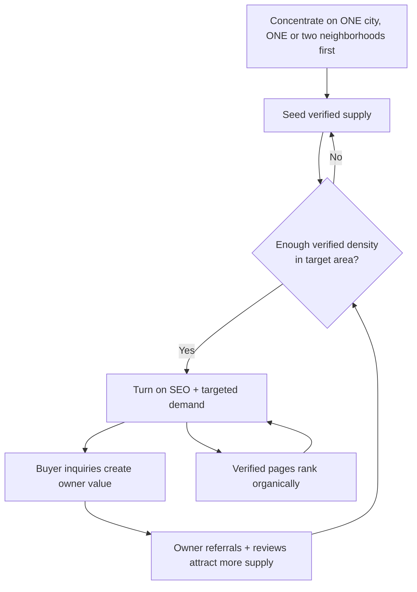

# Document 02 — Market & Competitive Analysis

**Project Codename:** HousePoint
**Document Owner:** Product Lead / Business Analyst
**Status:** DRAFT — Awaiting Approval
**Version:** 0.1.0
**Last Updated:** 2026-07-18
**Parent:** *Doc 01 — Product Vision, Strategy & Scope*

---

## 1. Purpose

This document defines **where HousePoint plays and how it wins**. It benchmarks the incumbents, isolates the structural weaknesses our **verification-first** wedge (*Doc 01, §5.4*) exploits, sizes the opportunity for a **single-city launch (Decision D-1)**, and specifies the **cold-start / go-to-market strategy** that supply-first marketplaces require. It converts the strategic bet from *Doc 01* into a defensible market position that engineering, ops, and marketing can build toward.

## 2. Scope

**In scope:**
- Competitive landscape teardown (direct + adjacent players)
- Feature & trust-model comparison matrix
- Structural weaknesses of incumbents we exploit
- HousePoint positioning statement & differentiation
- SWOT
- Market sizing framework (TAM/SAM/SOM) for a single-city launch
- Cold-start / chicken-and-egg strategy (the marketplace's hardest problem)
- Go-to-market motion for MVP
- Competitive risks & moats

**Out of scope (deferred):**
- Detailed monetization/pricing → *Doc 23*
- Personas & roles → *Doc 03*
- SEO tactics & content taxonomy → *Doc 11*
- Operations staffing model → *Doc 12*

## 3. Dependencies

| Dependency | Source | Notes |
|---|---|---|
| Vision, pillars, North Star | *Doc 01* | Positioning must serve the North Star (verified transactions) |
| Locked decisions D-1..D-4 | *Doc 01, §16* | Single city, 4 property types, owner-only, docs+ID+call verification |
| Launch city (OQ-1a) | Business | **Still open** — sizing here uses a *framework*; plug in real numbers once chosen |

## 4. Success Criteria

This document is "done" when:
1. Stakeholders agree on the **positioning statement (§8)** and the **top-3 differentiators**.
2. The **cold-start strategy (§11)** is accepted as the GTM spine for MVP.
3. The **competitive moats (§12)** are validated as realistic and defensible.
4. Sizing **assumptions** are confirmed so real numbers can be plugged once the launch city is chosen.

---

## 5. Market Context

Real-estate marketplaces are **classic two-sided networks**: supply (property listers) and demand (seekers). Value accrues to whoever controls the **trust and discovery layer**. Historically these platforms monetized *listing volume and lead resale*, which created a structural incentive to tolerate low-quality inventory.

### 5.1 The Three Marketplace Archetypes

| Archetype | Examples | Core promise | Structural flaw |
|---|---|---|---|
| **Classifieds / Aggregator** | 99acres, MagicBricks, Housing.com | "Everything is listed here" | Volume over truth → fakes, duplicates, stale, broker spam |
| **Broker-disintermediation** | NoBroker | "Skip the broker, save brokerage" | Still self-serve trust; verification is shallow/optional |
| **Portal + data** | Zillow, Realtor.com | "Data + estimates + agents" | Agent/MLS-centric; buyer is a lead to be sold |

**HousePoint is a fourth archetype: the *Verified Marketplace*** — trust is the product, not a filter toggle. Smaller catalog, near-zero noise.

---

## 6. Competitive Teardown

> Assessments below describe the **structural model** of each competitor, not a point-in-time feature audit. The purpose is to locate durable weaknesses, not to chase transient features.

### 6.1 NoBroker (India — broker disintermediation)
- **Strength:** Strong "no brokerage" brand; owner-direct; ancillary services (rent payment, packers, legal).
- **Weakness we exploit:** Trust is **self-declared**. Owner verification is light; buyers still encounter stale/duplicate/misrepresented listings. Their model optimizes *removing the broker*, not *guaranteeing truth*.
- **Our edge:** We remove the broker **and** guarantee verification. "No broker" is table stakes; "verified before public" is the upgrade.

### 6.2 MagicBricks / 99acres / Housing.com (India — classifieds)
- **Strength:** Massive inventory, brand recall, SEO dominance, developer/builder relationships.
- **Weakness we exploit:** **Volume model = noise.** Duplicate listings across brokers, bait pricing, "sold but still listed," lead resale to multiple brokers → buyer distrust. SEO is strong but trust-per-page is low.
- **Our edge:** Every indexed page is a **verified** page. We can't out-volume them; we out-*trust* them, and win the long tail of high-intent buyers who are tired of noise.

### 6.3 Zillow / Realtor.com (US — portal + data)
- **Strength:** Zestimate/data brand, agent network, MLS integration, financing adjacencies.
- **Weakness we exploit:** **Agent-centric**; the buyer is a lead sold to agents. Listing accuracy depends on MLS feeds, not first-party verification. Not applicable to owner-direct trust in non-MLS markets.
- **Our edge:** First-party human verification + owner-direct. In markets without MLS discipline (D-1 city dependent), this is a structural advantage.

### 6.4 Adjacent inspiration (not direct competitors)
- **Airbnb** — verification, reviews, and standardized trust made a scary transaction (stay in a stranger's home) safe. *Lesson: trust infrastructure unlocks hesitant demand.*
- **Booking.com** — obsessive funnel/SEO optimization and inventory freshness. *Lesson: freshness + structured content = organic dominance.*
- **Uber** — quality bar on supply (driver vetting) created reliability. *Lesson: gate supply quality to guarantee demand experience.*

---

## 7. Competitive Comparison Matrix

| Capability | 99acres / MagicBricks | Housing.com | NoBroker | Zillow/Realtor | **HousePoint** |
|---|---|---|---|---|---|
| Inventory volume | ★★★★★ | ★★★★ | ★★★ | ★★★★★ | ★★ (by design) |
| **Human verification before public** | ✗ | ✗ | Partial | ✗ (MLS-fed) | ★★★★★ **core** |
| Duplicate suppression | ✗ | Weak | Weak | Partial | ★★★★★ **core** |
| Owner-direct (no broker) | ✗ | ✗ | ★★★★ | ✗ | ★★★★★ |
| Fake/bait listing risk | High | High | Medium | Low-Med | **Very Low** |
| SEO / organic strength | ★★★★★ | ★★★★ | ★★★ | ★★★★★ | ★★★★ (target) |
| Buyer trust / NPS | Low | Low-Med | Medium | Medium | **High (target)** |
| Lead resold to many brokers | Yes | Yes | No | Yes (agents) | **No** |
| Transaction facilitation (future) | Weak | Weak | Partial | Strong | ★★★★★ (Phase 3) |

**Read:** We deliberately concede column 1 (volume) to win the rows that build a **trust moat**: verification, dedup, no-broker, low-fake, high-NPS.

---

## 8. Positioning

### 8.1 Positioning Statement
> **For** high-intent property seekers and genuine owners in [Launch City]
> **who** are frustrated by fake, duplicate, and broker-spammed listings,
> **HousePoint is** a verified real-estate marketplace
> **that** publishes only properties confirmed by a human operations team before they go public,
> **unlike** 99acres, MagicBricks, and NoBroker, which optimize for listing volume over listing truth.

### 8.2 Top-3 Differentiators (the story on every touchpoint)
1. **Verified-before-public** — a human checked this property, its owner, and its ownership. (Trust)
2. **No brokers, no bait** — talk to the actual owner; no duplicate listings, no fake pricing. (Directness)
3. **Every page is real** — what you see is available and accurate. (Quality)

### 8.3 Brand Promise
> "If it's on HousePoint, it's real."

### 8.4 What we deliberately are NOT
- Not the biggest catalog.
- Not a broker lead-generation engine.
- Not a self-serve wall of unverified posts.

---

## 9. SWOT

| | Helpful | Harmful |
|---|---|---|
| **Internal** | **Strengths:** Trust moat, clean UX, owner-direct, event-driven modular architecture, defensible ops process | **Weaknesses:** Verification cost/latency, low initial inventory, ops-staffing dependency, single-city concentration risk |
| **External** | **Opportunities:** Buyer distrust of incumbents, SEO long-tail of "verified/genuine" intent, B2B verified-data future, transaction-rails endgame | **Threats:** Incumbents' SEO/brand dominance, "fake verified badge" copycats, cold-start liquidity risk, regulatory/PII exposure |

---

## 10. Market Sizing Framework (Single-City)

> Real numbers require the chosen city (**OQ-1a**). This is the **model** to plug into; assumptions are explicit so any city can be dropped in.

```
TAM  = Total annual property transactions (sale + rent) in Launch City
       across the 4 in-scope types (residential sale, residential rent,
       commercial, land)  ×  average transaction value proxy

SAM  = Portion of TAM that is owner-listable & digitally reachable
       (owners willing to list online, D-3 owner-only)

SOM  = Realistic Year-1 verified-listing share we can capture
       = f(ops verification throughput, supply acquisition rate,
           organic + paid demand)
```

| Input | Placeholder | Source to confirm |
|---|---|---|
| City annual transactions (sale + rent, 4 types) | `TBD` | Govt registry / portal data |
| % owners open to owner-direct listing | `~20–30%` (assumption) | Survey / NoBroker penetration proxy |
| Ops verification throughput (listings/verifier/day) | `TBD` | *Doc 12* |
| Year-1 SOM target | `TBD` | Set after ops capacity known |

**Key insight:** Our SOM is **supply-constrained by verification throughput**, not by demand or code. This makes *Doc 12 (Ops Playbook)* a growth-critical document, and it makes verification-automation-assist (*Doc 01, §15*) the primary lever to raise the ceiling.

---

## 11. Cold-Start Strategy (the hardest problem)

Two-sided marketplaces die from the **chicken-and-egg** problem: buyers won't come without listings; owners won't list without buyers. Verification *worsens* the supply side (friction) but *strengthens* the demand side (trust). We resolve this deliberately.

### 11.1 Chosen approach: **Supply-first, single-city density**


**Why supply-first:** A buyer who visits a sparse catalog churns forever. Better to reach **local density** in a few neighborhoods so early buyers always find *something real*, then expand geographically.

### 11.2 Supply-seeding tactics (Phase 1)
| Tactic | Rationale |
|---|---|
| Direct ops outreach to owners in target neighborhoods | Manual, high-touch, builds initial verified inventory |
| **Free or subsidized verification at launch** | Remove the friction our own model introduces (revisit in *Doc 23*) |
| "Verified owner" badge + status as social proof | Owners want the credibility signal |
| Fast, respectful verification SLA | Owner experience is the supply retention lever (*Doc 12*) |

### 11.3 Demand-activation tactics (Phase 1→2)
| Tactic | Rationale |
|---|---|
| **SEO-first** verified pages (city → locality → property) | Compounding organic, our primary channel (*Doc 11*) |
| Trust-led messaging ("every listing verified") | Directly attacks incumbent pain |
| Saved searches + alerts (Phase 2) | Re-engagement, habit formation |
| Targeted local paid acquisition to bootstrap | Only until organic compounds |

### 11.4 The flywheel
> Verified supply → trustworthy buyer experience → high NPS + organic ranking → more buyers → owner value (real inquiries) → referrals + reviews → more verified supply.

Verification sits at the **head** of the flywheel: it's the cost that makes every downstream loop stronger.

---

## 12. Moats (Why this is defensible)

| Moat | Type | Why competitors can't easily copy |
|---|---|---|
| **Verification operations muscle** | Process/execution | It's expensive, human, and counter to incumbents' volume incentive; they'd have to cannibalize their model |
| **Trust brand ("if it's on HousePoint, it's real")** | Brand | Trust is earned over time and destroyed by one visible fake — incumbents can't retrofit it |
| **Verified-data asset** | Data | A growing corpus of *verified* properties/owners is uniquely valuable for B2B (banks, insurers) — *Doc 01 §15* |
| **Local density + SEO compounding** | Network + SEO | First-mover verified density in a city + ranking pages is hard to displace |
| **Modular event-driven platform** | Tech | Enables fast expansion of contexts (search, messaging, txn rails) without rewrites (*Doc 05*) |

**Copycat threat (R-5 from Doc 01):** a competitor slaps a "verified" badge on unverified listings. **Counter:** make verification *depth visible and auditable* (what was checked, when, by whom — surfaced on the listing), so our badge means more than theirs. Detailed in *Doc 07/11*.

---

## 13. Competitive Risks & Responses

| Risk | Response |
|---|---|
| Incumbents' SEO dominance buries us | Win long-tail "verified/genuine [locality] property" intent; superior structured data + freshness (*Doc 11*) |
| Incumbents launch a "verified" tier | We are verified-*only* and auditable; they can't be without hurting volume revenue |
| Cold-start stalls (no liquidity) | Supply-first neighborhood density (§11); free launch verification |
| Verification too slow → owners churn | SLA + tooling + automation-assist (*Doc 12*); measured as a KPI (*Doc 01 §9*) |
| Single-city concentration (one market downturn) | Architecture is multi-region-ready; expand once flywheel proven (*Doc 19*) |

---

## 14. Assumptions

| ID | Assumption | Risk if wrong |
|---|---|---|
| MA-1 | High-intent buyers value trust enough to accept smaller catalog | Wedge weakens; may need hybrid volume strategy |
| MA-2 | Enough owners in target city will self-list (D-3 owner-only) | Supply cold-start stalls; revisit broker/developer inclusion (OQ-7) |
| MA-3 | Free/subsidized verification at launch is affordable | GTM economics change; monetization pulled forward (*Doc 23*) |
| MA-4 | Organic SEO can meaningfully compete with incumbents on long-tail intent | Higher paid-acquisition dependency |
| MA-5 | Verification throughput can scale with demand | Growth ceiling; automation-assist becomes urgent |

## 15. Risks

| ID | Risk | Severity | Mitigation |
|---|---|---|---|
| R-02.1 | Cold-start liquidity failure | High | Supply-first density, subsidized verification (§11) |
| R-02.2 | Verification cost outpaces revenue | High | Phased monetization, automation-assist (*Doc 12/23*) |
| R-02.3 | Incumbent SEO moat too strong | Medium | Long-tail trust intent + structured data (*Doc 11*) |
| R-02.4 | Owner-only starves Commercial/Land supply (OQ-7) | Medium | Phase those types; consider verified developers later (*Doc 19*) |

## 16. Future Improvements / Scalability Notes

- **City-by-city playbook:** codify the single-city launch into a repeatable expansion runbook once the flywheel is proven.
- **Verified-data B2B products:** license the trust corpus to banks/insurers/valuers.
- **Trust score productization:** a per-listing/per-owner trust score as a visible, marketable asset.
- **Review/reputation layer:** post-transaction owner/buyer reputation to deepen the moat (Airbnb lesson).

## 17. Open Questions

| ID | Question | Owner | Blocking? |
|---|---|---|---|
| OQ-1a *(carried)* | Which specific launch city? | Business | Blocks real sizing numbers, SEO geo taxonomy |
| OQ-02.1 | Initial target **neighborhoods** within the city for density seeding? | Business/Ops | Blocks §11 execution |
| OQ-02.2 | Launch verification **free, subsidized, or paid**? | Business | Affects cold-start & *Doc 23* |
| OQ-02.3 | Primary competitor to benchmark against in chosen city? | Product | Sharpens positioning copy |

## 18. Related Documents

- **Parent:** *Doc 01 — Product Vision, Strategy & Scope*
- **Next:** *Doc 03 — Personas, User Roles & RBAC Matrix*
- **Referenced downstream:** *Doc 11 (SEO)*, *Doc 12 (Ops Playbook)*, *Doc 19 (Roadmap)*, *Doc 23 (Monetization)*

## 19. Revision History

| Version | Date | Author | Change |
|---|---|---|---|
| 0.1.0 | 2026-07-18 | Product Lead / BA | Initial draft for approval |

---

*End of Document 02.*
