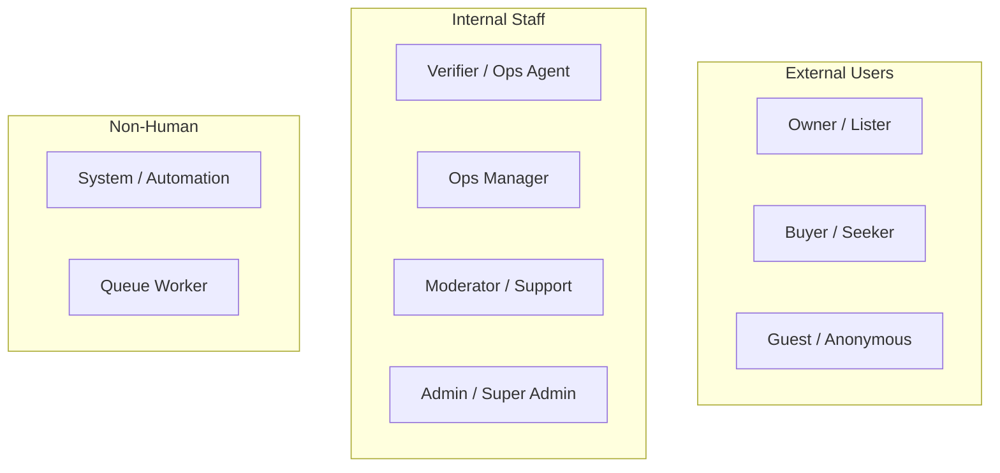
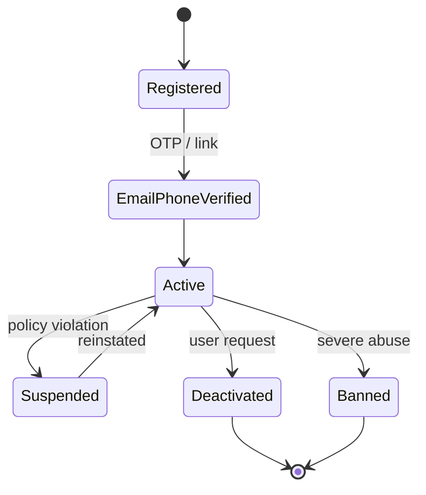

# Document 03 — Personas, User Roles & RBAC Matrix

**Project Codename:** HousePoint
**Document Owner:** Product / UX / Security
**Status:** DRAFT
**Version:** 0.1.0
**Last Updated:** 2026-07-18
**Parents:** *Doc 01 (Vision)*, *Doc 02 (Market)*

---

## 1. Purpose
Define **every human and system actor**, their goals, pains, and journeys, and the **canonical Role-Based Access Control (RBAC) matrix** that governs what each role may do. This is the authoritative source of roles/permissions that *Doc 10 (Security)* enforces and *Doc 09 (API)* checks.

## 2. Scope
**In:** personas, role taxonomy, permission matrix, role lifecycle, account states, delegation/escalation, system actors.
**Out:** auth token mechanics (*Doc 10*), API endpoint list (*Doc 09*), ops staffing (*Doc 12*).

## 3. Dependencies
- *Doc 01* decisions D-3 (owner-only), D-4 (verification = docs+ID+call).
- *Doc 02* moats (verification ops, trust brand).

## 4. Success Criteria
Approved role taxonomy, a permission matrix with no ambiguous cells, and account-state model that Security & API can implement without re-asking.

---

## 5. Actor Taxonomy

| Actor | Human? | MVP? | One-line |
|---|---|---|---|
| **Guest** | Yes | ✅ | Anonymous visitor browsing verified listings |
| **Buyer** | Yes | ✅ | Registered seeker who inquires, saves, messages |
| **Owner** | Yes | ✅ | Registered property owner who submits & manages listings |
| **Verifier** | Yes | ✅ | Ops agent who executes verification (docs+ID+call) |
| **Ops Manager** | Yes | ✅ | Supervises verification queue, SLAs, escalations |
| **Moderator/Support** | Yes | ✅ | Handles reports, disputes, user support, content moderation |
| **Admin** | Yes | ✅ | Platform configuration, user/role management, oversight |
| **Super Admin** | Yes | ✅ | Root: RBAC config, destructive ops, audit access |
| **System/Automation** | No | ✅ | Emits/consumes events, dedup checks, indexing, notifications |
| **Broker/Agent** | Yes | ❌ *(future, OQ-7)* | Modeled now, disabled in MVP |
| **Developer/Builder** | Yes | ❌ *(future)* | Bulk project inventory (post-MVP) |

> **D-3 enforcement:** Broker & Developer roles exist in the taxonomy but are **feature-flagged OFF** in MVP so RBAC needs no schema change when reopened.

---

## 6. Personas (Design Targets)

### 6.1 Owner — "Ravi, the genuine owner"
- **Goal:** Sell/rent his flat quickly to real buyers without broker spam or 40 junk calls.
- **Pains:** Fake inquiries, brokers scraping his number, listings buried under duplicates.
- **Needs:** Fast verification, a credible "verified" badge, control over who contacts him, quality inquiries.
- **Success:** Verified in <SLA, receives genuine buyer inquiries, feels in control.
- **Journey:** register → submit property → upload ownership docs + ID → ops call → verified & public → receive/manage inquiries → mark sold.

### 6.2 Buyer — "Priya, the high-intent seeker"
- **Goal:** Find a real, available property in her budget/locality without wasting weekends on fake listings.
- **Pains:** Bait pricing, "already sold," duplicates, being sold to 6 brokers.
- **Needs:** Trust signals, accurate availability, direct owner contact, good filters, saved searches.
- **Success:** Every listing she sees is real; she reaches the owner directly.
- **Journey:** discover (SEO/search) → browse verified listing → save/compare → inquire/message owner → visit → transact.

### 6.3 Verifier — "Anand, the ops agent"
- **Goal:** Verify listings accurately and fast against the SLA.
- **Pains:** Ambiguous documents, unreachable owners, unclear rejection criteria.
- **Needs:** A focused work queue, checklists, document viewer, call scripts, one-click decisions with reasons.
- **Success:** Clears queue within SLA with high decision quality (low post-approval complaints).
- **Journey:** pick next task → review docs → verify ID → call owner → record checklist → approve/reject/request-more-info.

### 6.4 Ops Manager — "Meera"
- **Goal:** Keep the queue within SLA, maintain decision quality, manage escalations.
- **Needs:** Queue dashboards, SLA/aging views, reassignment, audit of verifier decisions, fraud flags.

### 6.5 Moderator/Support — "Sameer"
- **Goal:** Resolve reports (fake/duplicate/abuse), disputes, and support tickets.
- **Needs:** Report queue, listing/user 360 view, actions (unpublish, warn, ban), audit trail.

### 6.6 Admin — "Nisha"
- **Goal:** Configure the platform (localities, property attributes, verification rules), manage staff & roles, monitor health.

---

## 7. Account & Verification States

### 7.1 User Account States

| State | Can log in | Can act |
|---|---|---|
| Registered | Yes | Limited (must verify contact) |
| EmailPhoneVerified | Yes | Buyer: full; Owner: may submit |
| Active | Yes | Full per role |
| Suspended | Yes (restricted) | Read-only |
| Deactivated | No | — |
| Banned | No | — |

> **Distinction:** *User verification* (contact/identity) ≠ *Property verification* (*Doc 07*). An Owner is a verified **user** who submits a property that then undergoes **property** verification. Owner identity check (D-4) is captured at property-verification time and reused for later listings.

---

## 8. RBAC Model

### 8.1 Principles
- **Least privilege** — default deny; grant explicitly.
- **Role = set of permissions**; user may hold multiple roles (e.g., Ops Manager also Verifier).
- **Permission = `resource:action[:scope]`** (e.g., `property:approve`, `listing:read:public`, `user:ban`).
- **Scopes:** `own` (only own records), `assigned` (assigned to me), `any` (all). Enables e.g. Owner `property:update:own`.
- Enforced in Yii2 via RBAC (auth items) at API layer (*Doc 09/10*); UI hides disallowed actions but **server is source of truth**.

### 8.2 Permission Domains
`auth`, `user`, `property`, `listing`, `media`, `document`, `verification`, `inquiry`, `message`, `report`, `savedsearch`, `config`, `analytics`, `rbac`, `audit`.

### 8.3 Canonical Role → Permission Matrix (MVP)

Legend: ✅ full · 🔵 own/assigned scope · ➖ none

| Permission | Guest | Buyer | Owner | Verifier | Ops Mgr | Moderator | Admin | Super Admin |
|---|---|---|---|---|---|---|---|---|
| `listing:read:public` | ✅ | ✅ | ✅ | ✅ | ✅ | ✅ | ✅ | ✅ |
| `search:query` | ✅ | ✅ | ✅ | ✅ | ✅ | ✅ | ✅ | ✅ |
| `auth:register` | ✅ | ➖ | ➖ | ➖ | ➖ | ➖ | ➖ | ➖ |
| `property:create` | ➖ | ➖ | ✅ | ➖ | ➖ | ➖ | ➖ | ✅ |
| `property:update` | ➖ | ➖ | 🔵own | ➖ | ➖ | ➖ | ✅ | ✅ |
| `property:delete` | ➖ | ➖ | 🔵own | ➖ | ➖ | ➖ | ✅ | ✅ |
| `document:upload` | ➖ | ➖ | 🔵own | ➖ | ➖ | ➖ | ➖ | ✅ |
| `document:view` | ➖ | ➖ | 🔵own | 🔵assigned | ✅ | 🔵case | ✅ | ✅ |
| `verification:claim` | ➖ | ➖ | ➖ | ✅ | ✅ | ➖ | ✅ | ✅ |
| `property:approve` | ➖ | ➖ | ➖ | 🔵assigned | ✅ | ➖ | ✅ | ✅ |
| `property:reject` | ➖ | ➖ | ➖ | 🔵assigned | ✅ | ➖ | ✅ | ✅ |
| `verification:reassign` | ➖ | ➖ | ➖ | ➖ | ✅ | ➖ | ✅ | ✅ |
| `inquiry:create` | ➖ | ✅ | ➖ | ➖ | ➖ | ➖ | ➖ | ➖ |
| `inquiry:read` | ➖ | 🔵own | 🔵own | ➖ | ➖ | 🔵case | ✅ | ✅ |
| `message:send` | ➖ | ✅ | 🔵own | ➖ | ➖ | ➖ | ➖ | ✅ |
| `savedsearch:manage` | ➖ | 🔵own | 🔵own | ➖ | ➖ | ➖ | ➖ | ✅ |
| `report:create` | ✅* | ✅ | ✅ | ➖ | ➖ | ➖ | ➖ | ➖ |
| `report:resolve` | ➖ | ➖ | ➖ | ➖ | 🔵 | ✅ | ✅ | ✅ |
| `listing:unpublish` | ➖ | ➖ | 🔵own | ➖ | ✅ | ✅ | ✅ | ✅ |
| `user:suspend` / `user:ban` | ➖ | ➖ | ➖ | ➖ | ➖ | ✅ | ✅ | ✅ |
| `config:manage` | ➖ | ➖ | ➖ | ➖ | 🔵ops | ➖ | ✅ | ✅ |
| `analytics:view` | ➖ | ➖ | 🔵own-stats | 🔵own-stats | ✅ | ✅ | ✅ | ✅ |
| `rbac:manage` | ➖ | ➖ | ➖ | ➖ | ➖ | ➖ | 🔵 | ✅ |
| `audit:view` | ➖ | ➖ | ➖ | ➖ | 🔵ops | 🔵case | ✅ | ✅ |

`*` Guest report requires captcha + contact; rate-limited.

### 8.4 Sensitive-Data Access Rule
Ownership documents & PII (IDs) are **restricted**: viewable only by the **assigned Verifier**, Ops Manager, Admin, Super Admin, and (own) the uploading Owner — every access is **audit-logged** (*Doc 10/22*). Buyers and Moderators (except on an active case) never see ownership docs.

---

## 9. Business Rules
- **BR-03.1** A user with `property:create` must be an Active, contact-verified Owner.
- **BR-03.2** A Verifier cannot approve a property they own or are related to (conflict of interest → auto-reassign).
- **BR-03.3** Approve/Reject requires a **reason code** (feeds analytics & appeals).
- **BR-03.4** Role changes are performed only by Admin/Super Admin and are audit-logged.
- **BR-03.5** Ban/suspend immediately unpublishes the user's public listings.
- **BR-03.6** Multiple roles union their permissions; the most permissive scope wins, but sensitive rules (BR-03.2) still apply.

## 10. Edge Cases
| Case | Handling |
|---|---|
| Owner is also a Buyer | One account, both role sets; cannot inquire on own listing |
| Verifier assigned a property they later realize they own | Self-declare conflict → reassign (BR-03.2) |
| Staff member leaves | Deactivate account; reassign open verifications; revoke roles |
| Guest hits owner contact | Gated: must register as Buyer (contact-verified) to inquire/message |
| Suspended owner with live inquiries | Listings read-only; existing threads frozen |

## 11. Assumptions
- One person = one account; roles layered on top.
- Staff roles provisioned by Admin, not self-signup.

## 12. Risks
| Risk | Mitigation |
|---|---|
| Privilege creep via multi-role union | Periodic RBAC audit; scope-aware checks |
| PII over-exposure to staff | Restricted docs + audit logging (§8.4) |
| Conflict-of-interest approvals | BR-03.2 auto-reassign + audit |

## 13. Future Improvements
- Attribute-Based Access Control (ABAC) overlay for fine-grained geo/team scoping at national scale.
- Broker & Developer roles activation (OQ-7) with their own verification tier.
- Just-in-time elevated access with approval for sensitive doc viewing.

## 14. Open Questions
| ID | Question | Owner |
|---|---|---|
| OQ-03.1 | Do we need a separate **Field Agent** role now for future physical-visit verification? | Ops |
| OQ-03.2 | Should Owners see *which* verifier handled them (transparency vs. privacy)? | Product/Legal |

## 15. Related Documents
Parent: *Doc 01, 02*. Enforced by *Doc 10 (Security)*, consumed by *Doc 09 (API)*, *Doc 07 (Verification)*, *Doc 18 (Admin)*. Next: *Doc 04*.

## 16. Revision History
| Version | Date | Author | Change |
|---|---|---|---|
| 0.1.0 | 2026-07-18 | Product/UX/Security | Initial draft |

---
*End of Document 03.*
