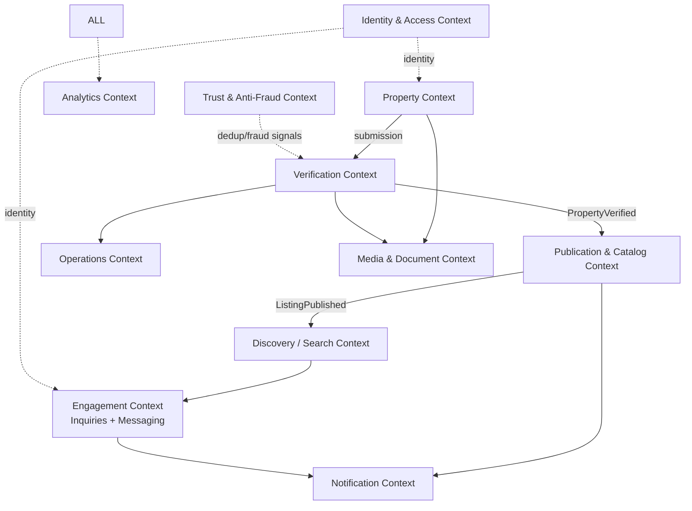
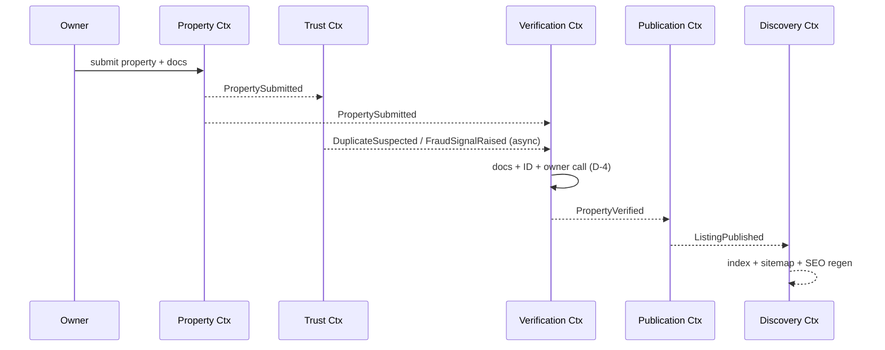

# Document 04 — Domain Model & Ubiquitous Language (DDD)

**Project Codename:** ValEstate
**Document Owner:** System Architect
**Status:** DRAFT
**Version:** 0.1.0
**Last Updated:** 2026-07-18
**Parents:** *Doc 01, 02, 03*

> ⭐ **Highest-leverage document.** This encodes our core bet. *Doc 05 (Architecture)*, *Doc 07 (Verification)*, *Doc 08 (Data Model)*, and *Doc 09 (API)* all derive from here. Terminology defined here is **binding** across the whole suite.

---

## 1. Purpose
Establish the **Domain-Driven Design** foundation: the **ubiquitous language**, **bounded contexts**, **aggregates/entities/value objects**, **domain events**, and **context relationships**. This gives every team one shared vocabulary and clear module seams so they can build in parallel without collisions.

## 2. Scope
**In:** glossary, bounded contexts, context map, per-context aggregates & invariants, domain events, cross-context integration patterns.
**Out:** physical schema (*Doc 08*), API shapes (*Doc 09*), infra (*Doc 05/20*).

## 3. Dependencies
Decisions D-1..D-4 (*Doc 01*); actors/roles (*Doc 03*); positioning (*Doc 02*).

## 4. Success Criteria
Every team can name the same concept the same way; context boundaries are unambiguous; the verification lifecycle is expressible as aggregate state + events.

---

## 5. Ubiquitous Language (Glossary)

| Term | Definition |
|---|---|
| **Property** | A real-world real-estate asset (flat/house/plot/commercial unit) owned by an Owner. The *thing*. |
| **Listing** | The **publishable representation** of a Property for a specific intent (sale or rent). A Property may have listings over time. |
| **Intent** | `SALE` or `RENT` — what the Owner wants to do with the Property. |
| **Property Type** | `RESIDENTIAL`, `COMMERCIAL`, `LAND` (D-2). Drives type-specific attributes. |
| **Submission** | An Owner's act of creating/editing a Property + docs, triggering verification. |
| **Verification** | The ops process (docs + ID + call, D-4) that decides if a Property becomes public. |
| **Verification Case** | The workflow aggregate tracking one verification attempt: claim, checklist, decision. |
| **Verifier** | Ops agent executing a Verification Case (*Doc 03*). |
| **Verified** | State where a Property has passed verification and is eligible to be public. |
| **Publication** | Making a verified Listing publicly visible & indexable (SEO). |
| **Inquiry** | A Buyer's expression of interest in a Listing (lead). |
| **Conversation/Thread** | Messaging channel between Buyer and Owner about a Listing. |
| **Ownership Document** | Proof-of-ownership artifact (deed, tax receipt, agreement) — sensitive. |
| **Identity Document** | Owner's ID artifact for D-4 identity check — sensitive/PII. |
| **Trust Signals** | Publicly shown facts (verified date, checks performed) that convey certainty. |
| **Duplicate Cluster** | A set of submissions the system believes refer to the same real Property. |
| **Locality** | Geographic taxonomy node (city → area → locality) powering search & SEO. |
| **Availability** | Whether a Listing is currently open (`AVAILABLE`, `UNDER_NEGOTIATION`, `CLOSED/SOLD/RENTED`). |
| **Reason Code** | Structured reason attached to reject/close/report actions. |

> **Naming rule:** never use "post", "ad", or "property" and "listing" interchangeably. **Property = the asset. Listing = its publishable offer.**

---

## 6. Bounded Contexts



| # | Bounded Context | Responsibility | Owns |
|---|---|---|---|
| 1 | **Identity & Access (IAM)** | Users, roles, auth, sessions | User, Role, Permission, Session |
| 2 | **Property** | Property asset data, type attributes, submissions, availability | Property (aggregate root), Address, Attributes |
| 3 | **Verification** | The verification lifecycle & decisions | VerificationCase, Checklist, Decision |
| 4 | **Media & Document** | Upload, storage refs, access control, sensitivity | MediaAsset, OwnershipDocument, IdentityDocument |
| 5 | **Publication & Catalog** | Publish/unpublish verified listings, canonical catalog | Listing, Publication, TrustSignal |
| 6 | **Discovery / Search** | Query, filter, geo, ranking (read model) | SearchIndexEntry, SavedSearch |
| 7 | **Engagement** | Inquiries + Buyer↔Owner messaging | Inquiry, Conversation, Message |
| 8 | **Trust & Anti-Fraud** | Dedup clustering, fraud signals, trust score | DuplicateCluster, FraudSignal, TrustScore |
| 9 | **Operations** | Queues, assignment, SLAs, staff workload | WorkQueue, Assignment, SLAClock |
| 10 | **Notification** | Email/SMS/push dispatch | NotificationRequest, Template, Channel |
| 11 | **Analytics** | Event ingestion, metrics, funnels | EventRecord, Funnel, Metric |

> **Why these seams:** Property (truth of the asset) is separated from Publication (public offer) so verification can gate publication cleanly. Verification is its own context because it is our **core differentiator** and must evolve independently (automation-assist later). Discovery is a **read model** fed by events — this is the seam that lets us swap MySQL search for OpenSearch/Meilisearch (*Doc 01 §10*, *Doc 05/13*) without touching write models.

---

## 7. Context Map (Relationships & Patterns)

| Upstream → Downstream | Pattern | Integration |
|---|---|---|
| IAM → all | **Shared Kernel** (identity) via JWT claims | Token carries userId + roles |
| Property → Verification | **Customer/Supplier** | `PropertySubmitted` event triggers case |
| Verification → Publication | **Customer/Supplier** | `PropertyVerified`/`PropertyRejected` events |
| Publication → Discovery | **Published Language** (events) | `ListingPublished`/`ListingUnpublished` build read model |
| Trust → Verification | **Conformist / assist** | Fraud/dup signals annotate case; human decides |
| Publication/Engagement → Notification | **Open Host / events** | Async notification requests |
| All → Analytics | **Event stream** | Fire-and-forget domain/tracking events |

**Anti-Corruption Layers (ACL):** external providers (SMS/email, future OCR/ML, payment) sit behind ACLs so vendor swaps don't leak into the domain.

---

## 8. Core Aggregates & Invariants

### 8.1 Property (aggregate root — Property Context)
```
Property
 ├─ id, ownerId
 ├─ propertyType: RESIDENTIAL | COMMERCIAL | LAND   (D-2)
 ├─ intent: SALE | RENT
 ├─ Address (VO): line, localityId, geo(lat,lng), pincode
 ├─ Attributes (type-specific VO set)
 ├─ media: [MediaAssetRef]
 ├─ documents: [DocumentRef]  (ownership + identity)
 ├─ status: DRAFT | SUBMITTED | IN_VERIFICATION | VERIFIED
 │          | REJECTED | PUBLISHED | UNPUBLISHED | ARCHIVED
 ├─ availability: AVAILABLE | UNDER_NEGOTIATION | CLOSED
 └─ version, timestamps
```
**Invariants:**
- I-1: Cannot transition to `SUBMITTED` without ≥1 ownership document + ≥N required media (config).
- I-2: Cannot be `PUBLISHED` unless `VERIFIED` (hard gate — the core bet).
- I-3: `propertyType` is immutable after `SUBMITTED` (re-submit = new flow).
- I-4: Attribute set must satisfy the schema for its `propertyType`.

> **Property status vs. Listing:** In MVP we keep publication state on the Property for simplicity, but the **Listing** is modeled as the publishable projection (Publication Context). This preserves the future where one Property yields multiple/historical Listings.

### 8.2 Type-Specific Attributes (Value Objects)
| Property Type | Example required attributes |
|---|---|
| RESIDENTIAL | bedrooms, bathrooms, carpet/built-up area, furnishing, floor, facing, age |
| COMMERCIAL | area, usage(office/retail/warehouse), floor, parking, power load |
| LAND | plot area, dimensions, zoning, boundary, road width, approvals |

Common (all types): price/rent, deposit(if rent), area unit, locality, geo, availability.

### 8.3 VerificationCase (aggregate root — Verification Context)
```
VerificationCase
 ├─ id, propertyId, ownerId
 ├─ state: UNCLAIMED | CLAIMED | DOC_REVIEW | ID_CHECK | OWNER_CALL
 │         | DECIDED | INFO_REQUESTED
 ├─ assignedVerifierId
 ├─ checklist: [ChecklistItem(result, note)]
 ├─ decision: APPROVED | REJECTED | null
 ├─ reasonCode, decisionNote
 ├─ slaClock (from Operations Context)
 └─ history: [StateTransition]
```
**Invariants:**
- I-5: Only the assigned Verifier (or Ops Mgr/Admin) may record a decision (BR-03.2/03.3).
- I-6: Decision requires all mandatory checklist items resolved + reason code.
- I-7: Verifier ≠ Owner (conflict-of-interest, BR-03.2).

### 8.4 Listing / Publication (Publication Context)
```
Listing
 ├─ id, propertyId
 ├─ slug (SEO), canonicalUrl
 ├─ trustSignals: verifiedAt, checksPerformed[], verificationTier
 ├─ visibility: PUBLIC | HIDDEN
 └─ publishedAt, unpublishedAt
```
Invariant I-8: A Listing exists only for a `VERIFIED` Property.

### 8.5 Inquiry & Conversation (Engagement Context)
```
Inquiry: id, listingId, buyerId, ownerId, message, status(NEW|RESPONDED|CLOSED), createdAt
Conversation: id, listingId, buyerId, ownerId, state(OPEN|FROZEN|CLOSED)
Message: id, conversationId, senderId, body, sentAt, readAt
```
Invariant I-9: Buyer cannot inquire/message on own Property (BR from *Doc 03*).

### 8.6 DuplicateCluster & TrustScore (Trust Context)
```
DuplicateCluster: id, memberPropertyIds[], confidence, status(SUSPECTED|CONFIRMED|DISMISSED)
FraudSignal: id, propertyId, type, severity, evidence
TrustScore: subjectId(property|owner), score, factors[]
```

---

## 9. Domain Events (the event backbone)

> These drive the event-driven workflows (*Doc 01 pillar 7*). Naming: past-tense, context-prefixed. Full payloads in *Doc 09/15*.

| Event | Emitted by | Triggers |
|---|---|---|
| `IAM.UserRegistered` | IAM | Welcome notification |
| `IAM.OwnerContactVerified` | IAM | Enables submission |
| `Property.PropertySubmitted` | Property | Create VerificationCase; run dedup/fraud checks |
| `Property.PropertyUpdated` | Property | Re-verify if material change |
| `Trust.DuplicateSuspected` | Trust | Annotate case; ops flag |
| `Trust.FraudSignalRaised` | Trust | Escalate case |
| `Verification.CaseClaimed` | Verification | SLA clock, assignment |
| `Verification.InfoRequested` | Verification | Notify owner |
| `Verification.PropertyVerified` | Verification | Create/Publish Listing; notify owner |
| `Verification.PropertyRejected` | Verification | Notify owner w/ reason; appeal path |
| `Publication.ListingPublished` | Publication | Build search index entry; SEO regen; sitemap |
| `Publication.ListingUnpublished` | Publication | Remove from index; SEO |
| `Engagement.InquiryCreated` | Engagement | Notify owner; analytics |
| `Engagement.MessageSent` | Engagement | Notify recipient |
| `Engagement.ListingMarkedClosed` | Engagement | Unpublish/label; North Star signal |



---

## 10. Business Rules (Domain-Level)
- **BR-04.1** Publication requires Verification (I-2) — non-negotiable.
- **BR-04.2** Material edits to a verified Property (price beyond threshold, address, docs) trigger **re-verification** (config-driven thresholds in *Doc 07*).
- **BR-04.3** A confirmed Duplicate collapses to a single canonical Listing; others rejected with `DUPLICATE` reason.
- **BR-04.4** Sensitive documents never appear in public/read models or Discovery.
- **BR-04.5** Every state transition is recorded (audit) with actor + timestamp + reason.

## 11. Edge Cases
| Case | Handling |
|---|---|
| Owner edits property mid-verification | Case → `INFO_REQUESTED`/restart per change materiality (BR-04.2) |
| Property verified then owner uploads worse photos | Non-material media edit stays public; material change re-verifies |
| Same flat submitted by two "owners" | Trust cluster → manual ownership adjudication (*Doc 07/12*) |
| Sold offline while public | Owner marks Closed → unpublish; counts toward North Star if genuine |
| Rent listing becomes sale | New intent = new Listing/verification, same Property asset |

## 12. Assumptions
- One real Property maps to one canonical Property aggregate (dedup enforces this).
- MVP keeps Listing lightweight (1:1 with verified Property); model allows 1:N later.

## 13. Risks
| Risk | Mitigation |
|---|---|
| Context boundaries blur under delivery pressure | This doc is binding; PRs reviewed against it |
| Event schema drift | Versioned event contracts (*Doc 09/15*) |
| Over-engineering DDD for MVP | Implement contexts as modules in a modular monolith first (*Doc 05*), split later |

## 14. Future Improvements
- Split high-load contexts (Discovery, Verification) into services at scale.
- Introduce Listing as full aggregate (multi-listing per property, history).
- Event sourcing for Verification (perfect audit) if compliance demands.

## 15. Open Questions
| ID | Question | Owner |
|---|---|---|
| OQ-04.1 | Re-verification thresholds (what % price change / which fields) — define values in *Doc 07*. | Ops/Product |
| OQ-04.2 | Is owner identity verified once (reused) or per-property? Proposed: once per owner, re-affirmed per property. | Ops/Legal |

## 16. Related Documents
Parents: *Doc 01, 02, 03*. Drives: *Doc 05, 07, 08, 09, 13, 15*. Next: *Doc 05*.

## 17. Revision History
| Version | Date | Author | Change |
|---|---|---|---|
| 0.1.0 | 2026-07-18 | System Architect | Initial draft |

---
*End of Document 04.*
