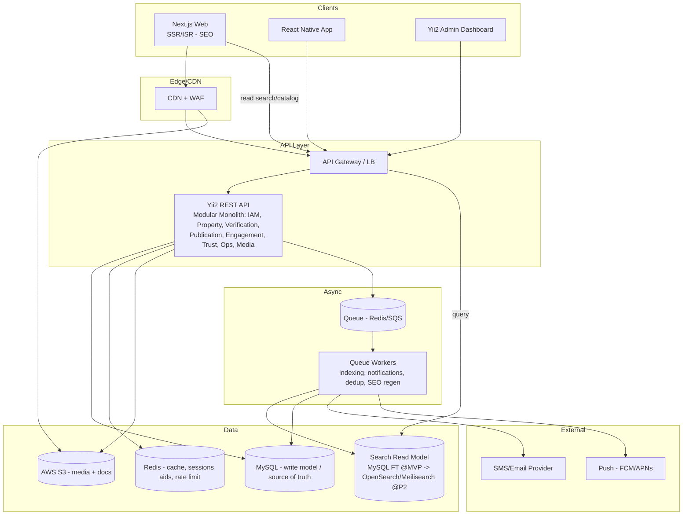
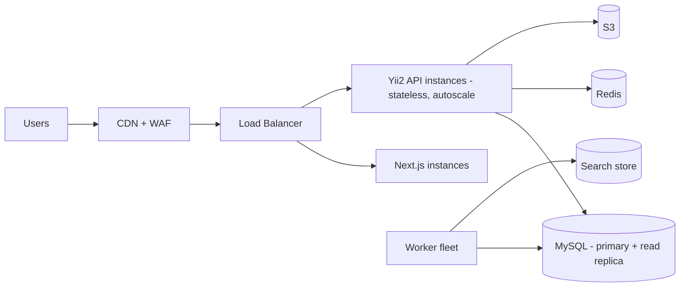

# Document 05 — System & Solution Architecture

**Project Codename:** HousePoint
**Document Owner:** Solution Architect
**Status:** DRAFT · **Version:** 0.1.0 · **Last Updated:** 2026-07-18
**Parents:** *Doc 01, 04*

---

## 1. Purpose
Define the **end-to-end technical architecture**: application topology, how the bounded contexts (*Doc 04*) map to deployable units, the event backbone, data stores, search strategy, caching, storage, and the request/read/write paths. This is the blueprint DevOps (*Doc 20*), Backend (*Doc 09*), and Frontend teams build against.

## 2. Scope
**In:** logical & deployment architecture, module/service decomposition, event bus, data/read-model strategy, caching, media, environments overview, key architectural decisions (ADRs).
**Out:** endpoint contracts (*Doc 09*), schema (*Doc 08*), infra provisioning detail (*Doc 20*).

## 3. Dependencies
Bounded contexts & events (*Doc 04*); fixed stack (*Doc 01 §10*); scale ambitions (*Doc 01 §11*).

## 4. Success Criteria
A topology that (a) launches fast as an MVP, (b) enforces verify-before-publish, (c) can split into services without rewrite, (d) supports SEO-first rendering and a swappable search read-model.

---

## 5. Architecture Principles
1. **Modular monolith first, services later.** Contexts (*Doc 04*) are **modules** inside the Yii2 backend at MVP, with clean interfaces + event contracts, so we get service-split optionality without premature distribution cost.
2. **API-first & stateless.** All clients (web, mobile, admin) consume the same REST API; no server session state (JWT).
3. **Event-driven writes.** State changes emit domain events onto a queue; workers handle side effects (indexing, notifications, SEO regen).
4. **CQRS-lite.** Write model = MySQL (source of truth). Read model for discovery = cache/search index built from events. Lets us swap search engines safely.
5. **SEO rendering at the edge.** Next.js SSR/ISR for public pages; the API serves data, Next renders indexable HTML.
6. **Security & audit are cross-cutting**, not a module.

---

## 6. Logical Architecture

## 7. Context → Module → (Future) Service Mapping

| Bounded Context (*Doc 04*) | MVP form | Future split trigger |
|---|---|---|
| IAM | Module | Rarely split; maybe auth service at scale |
| Property | Module | High write volume |
| Verification | Module | **First split** — core, evolves fast (automation-assist) |
| Media & Document | Module + S3 | Media processing service |
| Publication & Catalog | Module | With Discovery |
| Discovery/Search | **Read model** (separate store) | **Early split** — different scaling profile |
| Engagement | Module | Realtime messaging service |
| Trust & Anti-Fraud | Module + workers | ML service |
| Operations | Module (admin) | — |
| Notification | Worker(s) | Notification service |
| Analytics | Event sink | Data pipeline/warehouse |

> **Recommendation (ADR-002):** Do **not** start with microservices. The domain is young; boundaries will shift. A modular monolith + event contracts gives 90% of the benefit at 10% of the ops cost, and *Doc 04*'s clean seams make later extraction mechanical.

## 8. Request Paths

### 8.1 Write path (Owner submits property)
1. Web/Mobile → `POST /properties` (JWT, `property:create`).
2. API validates, persists Property (`SUBMITTED`) in MySQL, stores media/doc refs (S3 signed upload).
3. API emits `Property.PropertySubmitted` → Queue.
4. Workers: Trust dedup/fraud check → annotate; Verification creates `VerificationCase`; Notification confirms to owner.

### 8.2 Verification path
Verifier (Admin/API) claims case → checklist → decision → emits `PropertyVerified`/`Rejected` → Publication publishes Listing → `ListingPublished` → Discovery indexes + SEO regen + sitemap update + owner notified.

### 8.3 Read path (Buyer browses — SEO critical)
- Public listing pages: **Next.js SSR/ISR** fetch from catalog/search read model via API → fully rendered HTML + JSON-LD (*Doc 11*).
- Search/filters: API → **Search Read Model** (not the write DB) → cached in Redis/CDN.
- Media served from S3 via CDN.

## 9. Search Strategy (the key scale decision — ADR-003)

| Phase | Engine | Rationale |
|---|---|---|
| MVP (single city) | **MySQL** (indexed columns + FULLTEXT + bounding-box geo) | Low volume, fewer moving parts, fast to ship |
| Phase 2 (scale/national) | **OpenSearch or Meilisearch** read model, event-fed | Geo + facet + relevance ranking at scale |

Because Discovery is a **read model built from `ListingPublished` events**, swapping engines is additive: stand up the new index, replay events, cut over reads. **No write-model changes.** This is why *Doc 04* isolated Discovery.

> **Recommendation:** Meilisearch for speed-to-value (typo-tolerance, facets, simple ops) unless advanced geo/relevance or huge scale pushes us to OpenSearch. Decide at Phase 2 gate.

## 10. Caching Strategy (Redis + CDN)
| Layer | What | TTL / Invalidation |
|---|---|---|
| CDN edge | Public listing HTML (ISR), media, static | ISR revalidate on `ListingPublished/Unpublished`; media immutable w/ hashed URLs |
| Redis | Hot listing reads, search facets, locality trees, rate-limit counters, OTP, refresh-token denylist | Event-driven bust on publish/unpublish/update |
| App | Config, RBAC items | Bust on config change |

## 11. Media & Document Handling
- **Uploads:** client requests **pre-signed S3 URL** from API → uploads directly to S3 (offloads backend). API stores only the key + metadata.
- **Public media** (photos): served via CDN, hashed keys, image variants generated by worker (thumb/card/hero).
- **Sensitive docs** (ownership/ID): **private S3 bucket**, no CDN, access only via short-lived signed URLs to authorized roles (*Doc 03 §8.4*), every access audit-logged (*Doc 10/22*).

## 12. Eventing & Reliability
- **Bus:** Redis Streams / a queue (SQS acceptable). Events are versioned, idempotent, at-least-once.
- **Consumers idempotent** (dedup by eventId).
- **Outbox pattern:** write domain change + event in same MySQL transaction to an `outbox` table; a relay publishes to the queue → guarantees no lost events.
- **Dead-letter queue** for poison messages; ops alerting (*Doc 20*).

## 13. Deployment Topology (MVP)

- API & workers **stateless & horizontally scalable**.
- MySQL primary + **read replica** (reads/reporting); replica-ready from day 1.
- Environments: dev / staging / prod (*Doc 20*).

## 14. Cross-Cutting Concerns
| Concern | Approach | Doc |
|---|---|---|
| AuthN/Z | JWT + refresh + Yii2 RBAC | *Doc 10* |
| Observability | Structured logs, metrics, traces, correlation IDs | *Doc 20* |
| Audit | Append-only audit log of sensitive actions | *Doc 10/22* |
| Rate limiting | Redis token bucket per IP/user/route | *Doc 10* |
| Config | Central config (localities, attribute schemas, verification rules) | *Doc 18* |
| i18n-ready | Content keys + locale (future multi-region) | *Doc 11/19* |

## 15. Architecture Decision Records (ADRs)
| ADR | Decision | Status |
|---|---|---|
| ADR-001 | SSR/ISR (Next.js) for public pages for SEO-first | Accepted |
| ADR-002 | Modular monolith over microservices at MVP | Accepted |
| ADR-003 | Search as event-fed read model; MySQL→Meili/OpenSearch phased | Accepted |
| ADR-004 | Outbox + queue for reliable eventing | Accepted |
| ADR-005 | Direct-to-S3 uploads via pre-signed URLs | Accepted |
| ADR-006 | Sensitive docs in private bucket + signed short-lived access + audit | Accepted |
| ADR-007 | CQRS-lite (write=MySQL, read=cache/search) | Accepted |

## 16. Assumptions
- Single region infra at MVP (matches D-1 single city).
- Traffic dominated by reads (SEO/browse) → read-model + cache heavy.

## 17. Risks
| Risk | Mitigation |
|---|---|
| Monolith becomes big-ball-of-mud | Enforce module boundaries + event contracts; no cross-module DB reads |
| Event loss/duplication | Outbox + idempotent consumers + DLQ |
| Search rewrite pain later | Read-model isolation (ADR-003) makes it additive |
| SSR cost/latency | ISR + CDN caching; API read replicas |

## 18. Future Improvements
- Extract Verification & Discovery to services (triggers in §7).
- Realtime layer (WebSocket) for messaging/notifications.
- Multi-region active-passive → active-active at national scale.
- Data warehouse + streaming pipeline for analytics/ML.

## 19. Open Questions
| ID | Question | Owner |
|---|---|---|
| OQ-05.1 | Queue tech: Redis Streams vs. SQS vs. RabbitMQ for MVP? | DevOps/Backend |
| OQ-05.2 | Meilisearch vs. OpenSearch at Phase 2 — decide at gate. | Architect |

## 20. Related Documents
Parents: *Doc 01, 04*. Feeds: *Doc 08, 09, 11, 13, 20*. Next: *Doc 06*.

## 21. Revision History
| Version | Date | Author | Change |
|---|---|---|---|
| 0.1.0 | 2026-07-18 | Solution Architect | Initial draft |

---
*End of Document 05.*
