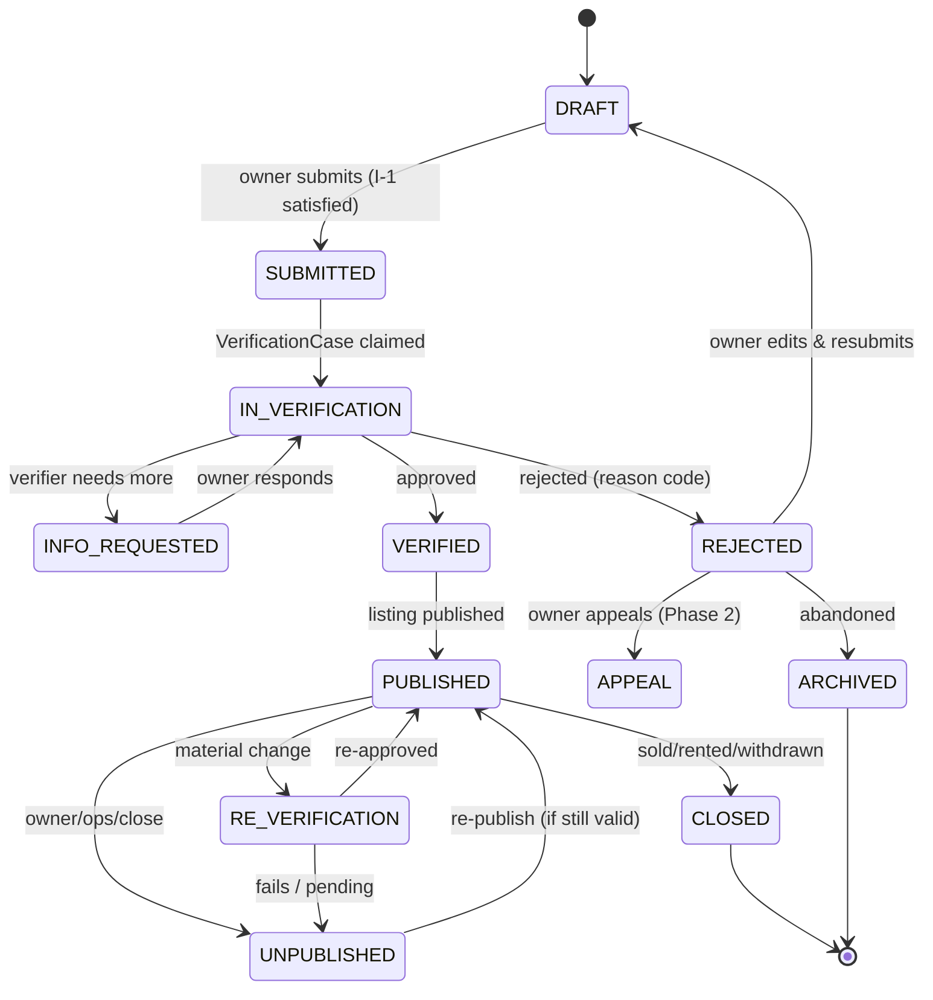
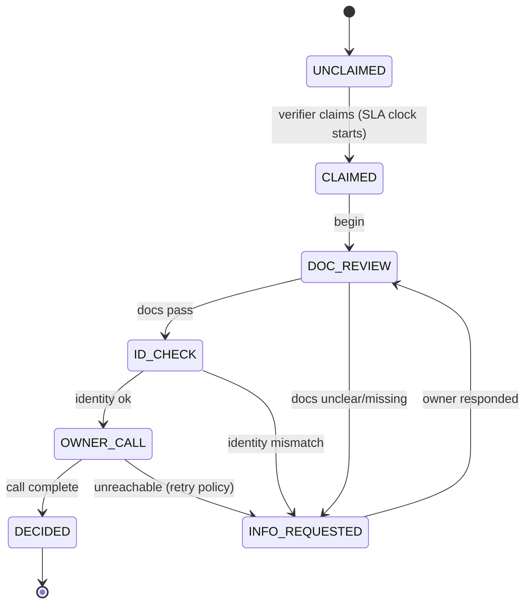
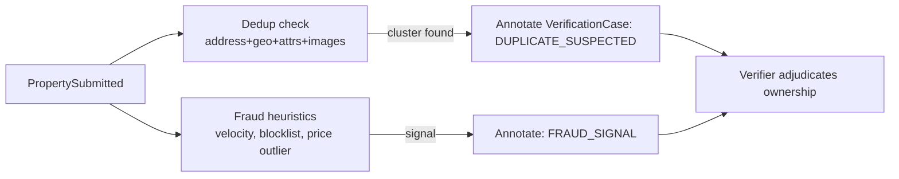

# Document 07 — Property Lifecycle & Verification Workflow

**Project Codename:** HousePoint
**Document Owner:** BA / Operations / Architect
**Status:** DRAFT · **Version:** 0.1.0 · **Last Updated:** 2026-07-18
**Parents:** *Doc 03, 04, 06*

> ⭐ **The core differentiator.** This is the operational heart of "verified before public" (*Doc 01*). Everything trust-related traces here.

---

## 1. Purpose
Specify the **complete property lifecycle** from draft to closed, and the **verification workflow** (D-4: docs + identity + call) in full: states, transitions, checklists, decision rules, reason codes, SLAs, info-request loops, re-verification, duplicate/fraud handling, and appeals. Detailed enough for Backend, Ops, Admin, and QA to implement with zero ambiguity.

## 2. Scope
**In:** property state machine, verification state machine, checklist by property type, decision/reason taxonomy, SLA model, re-verification rules, dedup/fraud integration, appeals, notifications, edge cases.
**Out:** ops staffing/rostering (*Doc 12*), API shapes (*Doc 09*), UI (*Doc 18*).

## 3. Dependencies
Domain aggregates & events (*Doc 04*); RBAC (*Doc 03*); decisions D-2 (4 types), D-4 (verification method).

## 4. Success Criteria
A deterministic, auditable verification flow with SLA-bound stages, configurable checklists per property type, and clear owner communication at every step.

---

## 5. Property Lifecycle State Machine

| State | Public? | Owner can edit? | Notes |
|---|---|---|---|
| DRAFT | No | Yes | Not yet submitted |
| SUBMITTED | No | Locked* | Awaiting verifier claim |
| IN_VERIFICATION | No | Locked* | Being reviewed |
| INFO_REQUESTED | No | Yes (requested fields) | Ball in owner's court; SLA paused |
| VERIFIED | No (transient) | No | Eligible to publish |
| PUBLISHED | **Yes** | Limited (non-material) | Live listing |
| RE_VERIFICATION | Yes (stays live)** | Locked* | Material change under review |
| REJECTED | No | Yes (→DRAFT) | With reason |
| CLOSED | No | No | Sold/rented/withdrawn — North Star signal |
| ARCHIVED | No | No | Terminal |

`*` Edits during review route to INFO_REQUESTED or restart per materiality (§9).
`**` Policy choice: keep live during re-verification of minor changes, auto-unpublish if change is high-risk (config).

## 6. Verification Workflow (D-4: Docs + Identity + Call)

### 6.1 Verification Case State Machine

### 6.2 The Three Verification Pillars
| Pillar | What verifier does | Pass condition |
|---|---|---|
| **1. Ownership documents** | Open sensitive docs, confirm they match the property & owner name | Valid doc, name matches, property matches, not expired/forged-looking |
| **2. Identity** | Confirm owner ID matches document holder | ID valid, matches ownership doc name / authorized owner |
| **3. Owner call** | Phone the owner, confirm availability, price, intent, willingness | Owner reachable, confirms details, consents to publish |

### 6.3 Configurable Checklist (by Property Type)
> Checklists are **config-driven** (Admin, *Doc 18*), not hardcoded. Baseline:

| Checklist item | RESIDENTIAL | COMMERCIAL | LAND | Mandatory |
|---|---|---|---|---|
| Ownership document present & legible | ✓ | ✓ | ✓ | Yes |
| Ownership doc name matches owner | ✓ | ✓ | ✓ | Yes |
| Identity document verified | ✓ | ✓ | ✓ | Yes |
| Property address matches documents | ✓ | ✓ | ✓ | Yes |
| Photos match described property | ✓ | ✓ | ✓ | Yes |
| Price/rent sanity (not obviously bait) | ✓ | ✓ | ✓ | Yes |
| Owner reachable & confirms (call) | ✓ | ✓ | ✓ | Yes |
| Title/encumbrance indication | — | ○ | ✓ | Land: Yes |
| Zoning/approval indication | — | ○ | ✓ | Land/Comm: recommended |
| Usage/commercial permission | — | ✓ | — | Comm: Yes |
| No duplicate cluster conflict | ✓ | ✓ | ✓ | Yes |

✓ required · ○ recommended · — n/a

### 6.4 Decision Rules
- **APPROVE** iff **all mandatory** checklist items pass **and** no unresolved fraud/duplicate escalation.
- **REJECT** if any hard-fail (forged/invalid docs, identity mismatch, confirmed duplicate, owner denies, bait pricing) → **reason code required**.
- **INFO_REQUESTED** if fixable gap (blurry doc, missing photo, unreachable) → owner loop.
- Conflict of interest (verifier owns/related) → **auto-reassign** (BR-03.2), never self-decide.

### 6.5 Reason Code Taxonomy (structured)
| Category | Codes |
|---|---|
| Document | `DOC_MISSING`, `DOC_ILLEGIBLE`, `DOC_NAME_MISMATCH`, `DOC_SUSPECTED_FORGERY`, `DOC_EXPIRED` |
| Identity | `ID_MISMATCH`, `ID_INVALID`, `ID_MISSING` |
| Property | `ADDRESS_MISMATCH`, `PHOTOS_MISMATCH`, `BAIT_PRICING`, `INCOMPLETE_ATTRIBUTES` |
| Owner | `OWNER_UNREACHABLE`, `OWNER_DECLINED`, `OWNER_NOT_AUTHORIZED` |
| Trust | `DUPLICATE_CONFIRMED`, `FRAUD_SUSPECTED`, `BLOCKLISTED` |
| Other | `POLICY_VIOLATION`, `OUT_OF_COVERAGE` |

Reason codes feed analytics (*Doc 15*), owner messaging (*Doc 14/NOTF*), and appeals.

## 7. SLA Model
| Stage | SLA target (config) | Clock behavior |
|---|---|---|
| SUBMITTED → CLAIMED | e.g. within X business hours | Counts against ops responsiveness |
| CLAIMED → DECIDED | e.g. within Y business hours | Core verification SLA |
| INFO_REQUESTED (owner) | e.g. owner has Z days | **Owner clock** — ops SLA paused |
| Owner-call retries | e.g. 3 attempts across W hours | Then INFO_REQUESTED or auto-reject `OWNER_UNREACHABLE` |

- SLA breaches surface in Ops dashboards (*Doc 12*), trigger escalation to Ops Manager.
- Actual numeric targets set in *Doc 12* once staffing/city known (OQ-1a).

## 8. Duplicate & Fraud Integration (Trust Context)

- **Duplicate minimization:** on submit, cluster by normalized address + geo proximity + attribute similarity + image hash. If suspected, verifier sees the cluster and adjudicates true owner; others → `DUPLICATE_CONFIRMED`. Canonical listing kept (BR-04.3).
- **Fake minimization:** the human call + doc + ID triad (D-4) is the primary defense; heuristics assist, human decides. Phase 3 adds OCR/image-forensics/ML **assist** (never auto-approve).
- **Fraud minimization:** velocity limits (many submissions fast), blocklists (numbers/IDs), price-outlier flags, repeat-rejection patterns.

## 9. Re-Verification Rules (material change)
On edit of a PUBLISHED property, classify change:
| Change | Material? | Action |
|---|---|---|
| Price/rent within ±T% (config) | No | Live, no re-verify |
| Price/rent beyond ±T% | Yes | RE_VERIFICATION (quick) |
| Address / geo | Yes | Full re-verification |
| Ownership documents | Yes | Full re-verification |
| Property type | Blocked | New submission (I-3) |
| Photos (add/replace, same property) | No | Live (light media check async) |
| Description/attributes minor | No | Live |
| Availability toggle | No | Live |
Thresholds `T` and field list are config (resolves OQ-04.1).

## 10. Appeals (Phase 2)
Rejected owner may appeal once → routed to **Ops Manager** (not original verifier) → uphold or overturn with note. Prevents unfair rejections eroding supply. Tracked with reason + outcome for quality metrics.

## 11. Owner Communication (per transition)
| Transition | Channel | Message intent |
|---|---|---|
| SUBMITTED | email/SMS/push | "Received, under verification, expect by <SLA>" |
| INFO_REQUESTED | all | Exactly what's needed + link |
| VERIFIED/PUBLISHED | all | "You're live! + verified badge" |
| REJECTED | all | Reason (human-readable) + how to fix / appeal |
| RE_VERIFICATION | all | What triggered it + status |
Templates owned by *Doc 14/NOTF*.

## 12. Business Rules
- **BR-07.1** No property is PUBLIC without a DECIDED=APPROVED case (I-2). Absolute.
- **BR-07.2** Every decision has actor + timestamp + reason code (audit).
- **BR-07.3** Owner identity, once verified, is reused for that owner's future submissions but **re-affirmed** on the call (resolves OQ-04.2).
- **BR-07.4** Sensitive docs accessible only to assigned verifier + ops mgr/admin, audit-logged (*Doc 03 §8.4*).
- **BR-07.5** Confirmed duplicates collapse to one canonical listing.
- **BR-07.6** Owner-unreachable after retry policy → INFO_REQUESTED then time-boxed auto-close, not silent limbo.

## 13. Edge Cases
| Case | Handling |
|---|---|
| Owner uploads doc for a different property | ADDRESS_MISMATCH → INFO_REQUESTED/REJECT |
| Two owners claim same property | Ops adjudication; possibly both rejected pending legal proof |
| Owner reachable but refuses call verification | OWNER_DECLINED → cannot publish |
| Docs valid but photos are stock/mismatched | PHOTOS_MISMATCH → INFO_REQUESTED |
| Property sold during verification | Owner marks closed → case cancelled |
| Verifier goes offline mid-case | Ops Manager reassigns; SLA continues |
| Price obviously bait to farm leads | BAIT_PRICING reject; repeat → fraud signal |
| Re-verification of live listing fails | Unpublish + notify + reason |
| Owner edits during IN_VERIFICATION | Route to INFO_REQUESTED or restart per materiality (§9) |

## 14. Metrics (feeds Doc 15)
Verification turnaround (median/p90), approval vs. rejection rate, rejection reason distribution, info-request rate, owner-unreachable rate, duplicate-catch rate, post-approval complaint rate (decision quality), SLA breach rate, appeal overturn rate.

## 15. Assumptions
- Human-in-the-loop for all decisions at MVP; automation only assists later.
- Owner provides genuine phone reachable during ops hours.

## 16. Risks
| Risk | Mitigation |
|---|---|
| Verification bottleneck (Doc 01 R-1) | SLA + tooling + automation-assist roadmap |
| Inconsistent verifier judgment | Config checklist + reason codes + QA sampling (*Doc 12/21*) |
| Owner drop-off at verification friction | Fast SLA, clear comms, minimal doc asks |
| Sophisticated forged docs slip through | Call + cross-checks + Phase-3 forensics; report-driven re-review |

## 17. Future Improvements
- OCR auto-extraction & name-matching assist.
- Image forensics / reverse-image duplicate detection.
- Video-call / geo-tagged photo verification option.
- Government registry API integration for title checks.
- Risk-based verification tiers (fast-track trusted owners).

## 18. Open Questions
| ID | Question | Owner |
|---|---|---|
| OQ-07.1 | Exact required document set per property type (per launch-city legal norms). | Ops/Legal |
| OQ-07.2 | Keep listing live during minor re-verification, or always unpublish? | Product/Ops |
| OQ-07.3 | Numeric SLA targets — set in *Doc 12*. | Ops |

## 19. Related Documents
Parents: *Doc 03, 04, 06*. Feeds: *Doc 08 (schema), 09 (API), 12 (Ops), 14 (comms), 15 (metrics), 18 (Admin console)*. Next: *Doc 08*.

## 20. Revision History
| Version | Date | Author | Change |
|---|---|---|---|
| 0.1.0 | 2026-07-18 | BA/Ops/Architect | Initial draft |

---
*End of Document 07.*
