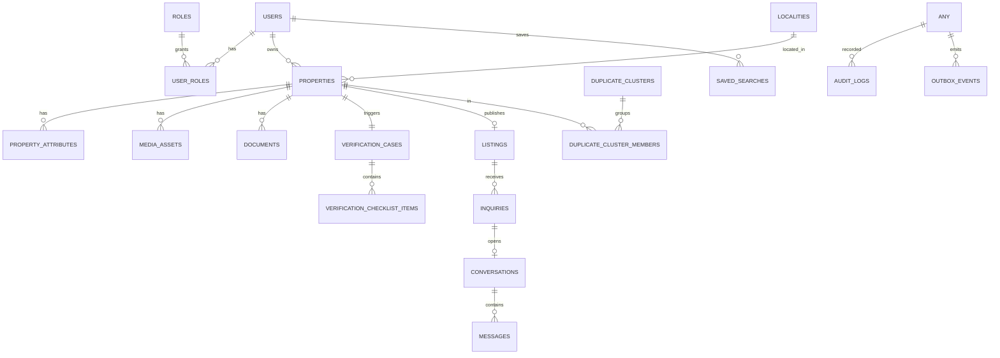

# Document 08 — Data Model & Database Architecture

**Project Codename:** HousePoint
**Document Owner:** Database Architect
**Status:** DRAFT · **Version:** 0.1.0 · **Last Updated:** 2026-07-18
**Parents:** *Doc 04, 05, 07*

---

## 1. Purpose
Translate the domain model (*Doc 04*) and verification workflow (*Doc 07*) into a **concrete MySQL schema**, with indexing, partitioning readiness, the read-model/search strategy, media/document storage, auditing, and data-integrity rules. Detailed enough for backend to build migrations.

## 2. Scope
**In:** entity tables, keys, relationships, enums, indexes, JSON attribute strategy, audit/outbox tables, PII handling, retention, read-model shape.
**Out:** ORM code, exact DDL migrations (derived by backend), search-engine internals (*Doc 13*).

## 3. Dependencies
Aggregates/invariants (*Doc 04*), verification states/checklists (*Doc 07*), architecture CQRS-lite + outbox (*Doc 05*).

## 4. Success Criteria
Schema enforces core invariants (esp. verify-before-publish), supports the 4 property types with type-specific attributes, is index-tuned for read-heavy SEO/search, and is auditable.

---

## 5. Conventions
- **Engine:** InnoDB, `utf8mb4`. **PKs:** `BIGINT UNSIGNED AUTO_INCREMENT` (public-facing via opaque `uuid`/`slug` to avoid enumeration).
- **Timestamps:** `created_at`, `updated_at` (UTC); soft-delete `deleted_at` where needed.
- **Enums** stored as short `VARCHAR` + app-level enum (avoid native ENUM for flexibility) with CHECK/lookup tables.
- **Money:** integer minor units + currency code.
- **Naming:** snake_case tables (plural), FK `<entity>_id`.

## 6. Entity-Relationship Overview

## 7. Core Tables

### 7.1 IAM
**users**: `id, uuid, name, email(unique), phone(unique), password_hash, status(REGISTERED|ACTIVE|SUSPENDED|DEACTIVATED|BANNED), email_verified_at, phone_verified_at, created_at, updated_at`
**roles**: `id, key(unique), name`
**user_roles**: `user_id, role_id` (PK composite)
**refresh_tokens**: `id, user_id, token_hash, device_id, expires_at, revoked_at, created_at` (rotation, *Doc 10*)
**auth_otps**: `id, user_id, purpose, code_hash, expires_at, consumed_at`

### 7.2 Property Context
**properties**
| col | type | notes |
|---|---|---|
| id / uuid | BIGINT / CHAR(26) | uuid public |
| owner_id | FK users | |
| property_type | VARCHAR | RESIDENTIAL/COMMERCIAL/LAND (immutable post-submit, I-3) |
| intent | VARCHAR | SALE/RENT |
| title | VARCHAR | |
| description | TEXT | |
| locality_id | FK localities | |
| address_line | VARCHAR | |
| pincode | VARCHAR | |
| geo_lat / geo_lng | DECIMAL(10,7) | spatial index |
| price_minor / currency | BIGINT / CHAR(3) | sale price or rent |
| deposit_minor | BIGINT NULL | rent only |
| area_value / area_unit | DECIMAL / VARCHAR | |
| status | VARCHAR | DRAFT..CLOSED/ARCHIVED (*Doc 07 §5*) |
| availability | VARCHAR | AVAILABLE/UNDER_NEGOTIATION/CLOSED |
| version | INT | optimistic locking |
| submitted_at, verified_at, published_at, closed_at | DATETIME NULL | |

**property_attributes** (type-specific, EAV-lite): `id, property_id, attr_key, attr_value, value_type` — *plus* a denormalized `attributes_json` JSON column on `properties` for fast reads. **Rationale:** JSON column serves read/render cheaply; the normalized table enables filterable/indexable attributes for search sync. Attribute **schemas per type are config** (admin), validated app-side.

> **DB Architect note:** MySQL 8 supports **functional/multi-valued indexes on JSON** — hot filter attributes (bedrooms, area) get generated columns + indexes; rare ones stay in JSON only. Best of both.

### 7.3 Media & Document
**media_assets**: `id, property_id, s3_key, kind(PHOTO|FLOORPLAN|VIDEO), variant_json, width, height, sort_order, status, created_at` — **public bucket + CDN**.
**documents**: `id, property_id, owner_id, doc_type(OWNERSHIP|IDENTITY|OTHER), s3_key, sensitivity('RESTRICTED'), checksum, uploaded_at` — **private bucket**, access via signed URL + audit only (*Doc 03 §8.4*, *Doc 10*). **No document content or key exposed in any read model.**

### 7.4 Verification Context
**verification_cases**: `id, property_id(unique active), owner_id, state(*Doc 07 §6.1*), assigned_verifier_id NULL, decision(APPROVED|REJECTED|NULL), reason_code NULL, decision_note NULL, claimed_at, decided_at, sla_due_at, created_at`
**verification_checklist_items**: `id, case_id, item_key, result(PASS|FAIL|NA|PENDING), note, updated_by, updated_at`
**verification_events**: append-only transitions `id, case_id, from_state, to_state, actor_id, reason_code, at` (audit of the core flow).

### 7.5 Publication & Catalog
**listings**: `id, uuid, property_id(unique), slug(unique), canonical_url, visibility(PUBLIC|HIDDEN), verified_at, verification_tier, checks_performed_json, published_at, unpublished_at`
**trust_signals** (denormalized onto listing or here): verified date, checks performed, verifier-team (not individual, per OQ-03.2 pending).

### 7.6 Engagement
**inquiries**: `id, listing_id, buyer_id, owner_id, message, status(NEW|RESPONDED|CLOSED), created_at`
**conversations**: `id, listing_id, buyer_id, owner_id, state(OPEN|FROZEN|CLOSED), created_at`
**messages**: `id, conversation_id, sender_id, body, sent_at, read_at NULL` (partition-ready by created month at scale).

### 7.7 Trust & Anti-Fraud
**duplicate_clusters**: `id, status(SUSPECTED|CONFIRMED|DISMISSED), confidence, canonical_property_id NULL, created_at`
**duplicate_cluster_members**: `cluster_id, property_id, similarity`
**fraud_signals**: `id, property_id, type, severity, evidence_json, created_at`
**trust_scores**: `id, subject_type(PROPERTY|OWNER), subject_id, score, factors_json, computed_at`
**reports**: `id, listing_id, reporter_id NULL, reporter_contact, reason_code, note, status(OPEN|RESOLVED|DISMISSED), resolved_by, created_at`
**blocklist**: `id, type(PHONE|EMAIL|ID|IP), value_hash, reason, created_at`

### 7.8 Operations
**work_queue_items**: `id, case_id, queue_key, priority, assigned_to, state, aging_since` (can be a view over verification_cases + policy).
Staff workload/rota → *Doc 12* (may be app/config, not heavy schema at MVP).

### 7.9 Geo / Taxonomy
**localities**: `id, parent_id NULL, level(CITY|AREA|LOCALITY), name, slug, geo_polygon NULL, seo_meta_json` — powers search + SEO landing pages.

### 7.10 Saved Search & Notifications
**saved_searches**: `id, buyer_id, query_json, alert_frequency, last_run_at`
**notification_requests**: `id, user_id, channel(EMAIL|SMS|PUSH), template_key, payload_json, status, sent_at`
**notification_prefs**: `user_id, channel, category, enabled`

### 7.11 Cross-Cutting
**audit_logs**: `id, actor_id, action, resource_type, resource_id, meta_json(redacted), ip, at` — **append-only**; **every sensitive-doc access + every verification decision + every RBAC change** logged (*Doc 03/07/10/22*).
**outbox_events**: `id, aggregate_type, aggregate_id, event_type, payload_json, version, published_at NULL, created_at` — **transactional outbox** (ADR-004); relay marks `published_at`.
**config_*** tables: attribute schemas, checklist templates, reason codes, SLA config, localities SEO.

## 8. Key Indexes (read-heavy tuning)
| Table | Index | Why |
|---|---|---|
| properties | (status, locality_id, intent, property_type) | catalog/search filters |
| properties | SPATIAL(geo) / (geo_lat, geo_lng) | map/radius (Phase 2) |
| properties | generated cols (bedrooms, area) + idx | attribute filters |
| listings | slug(unique), (visibility, published_at) | public lookup, freshness |
| verification_cases | (state, sla_due_at), (assigned_verifier_id, state) | ops queue |
| messages | (conversation_id, sent_at) | thread load |
| inquiries | (owner_id, status), (listing_id) | owner dashboard |
| audit_logs | (resource_type, resource_id, at) | investigations |
| outbox_events | (published_at NULL) | relay scan |

## 9. Integrity & Invariant Enforcement
| Invariant (*Doc 04/07*) | Enforcement |
|---|---|
| I-2 Publish ⇒ Verified | App service + FK: a `listings` row created only via publication service triggered by `PropertyVerified`; DB check `listings.property_id` must have verified case (app-guaranteed; optionally trigger). |
| I-1 Submit needs docs+media | App validation on submit transition |
| I-3 type immutable | App guard + no update path exposed |
| Unique active verification case per property | Partial-unique via `property_id` + state (app + unique index on open case) |
| Buyer ≠ owner on inquiry | App check |
| Audit completeness | Service-layer interceptor writes audit_logs |

> **Why app-enforced, not all DB constraints:** invariants spanning aggregates/events (publish-after-verify) live in the service layer where the domain lives (*Doc 04*); DB provides last-line uniqueness/FK guards. Documented so QA (*Doc 21*) tests both layers.

## 10. Read Model / Search Sync
- On `ListingPublished/Unpublished/Updated`, a worker writes a **denormalized search document**: listing + property core + attributes + locality + trust signals + geo — **excluding all sensitive doc/PII**.
- MVP: a `listing_search` denormalized table (or MySQL FULLTEXT). Phase 2: same document shipped to Meili/OpenSearch (*Doc 05 ADR-003*, *Doc 13*).

## 11. PII, Sensitivity & Retention
| Data | Class | Handling |
|---|---|---|
| Ownership/Identity docs | **Restricted PII** | Private bucket, signed access, audit, encrypt at rest, **retention limited** (e.g. purge N days after CLOSED/REJECTED per *Doc 22*) |
| Owner/buyer contact | PII | Encrypted at rest, access-controlled, never in public read model |
| Passwords | Secret | Argon2/bcrypt hash only |
| Refresh tokens/OTP | Secret | Hashed, TTL |
| Messages | Personal | Access-limited to participants + moderation-on-case |
- **Right-to-erasure / data export** hooks (*Doc 22*): user deletion anonymizes PII, preserves aggregate/audit integrity.

## 12. Scalability & Partitioning Readiness
- Read replica from day 1 (*Doc 05*).
- High-growth tables (`messages`, `audit_logs`, `outbox_events`, analytics events) **partition-by-time ready**; archive cold partitions.
- `properties`/`listings` shardable by city/region at national scale (D-1 single city now → region key later).
- Analytics events go to a separate sink/warehouse (*Doc 15*), not the OLTP DB.

## 13. Assumptions
- Single MySQL cluster (primary+replica) suffices for single-city MVP.
- Attribute schemas evolve via config, not migrations, for common cases.

## 14. Risks
| Risk | Mitigation |
|---|---|
| EAV attribute queries slow | Generated columns + JSON indexes for hot filters (§7.2) |
| Cross-aggregate invariant bypass | Service-layer enforcement + audit + tests |
| PII leakage into read model | Explicit exclusion + review + tests (*Doc 21*) |
| Message/audit table bloat | Time partitioning + archival |

## 15. Future Improvements
- Move search to dedicated engine (Phase 2).
- Introduce Listing history (multi-listing per property).
- Column-level encryption / tokenization vault for docs.
- CDC (change-data-capture) to warehouse.

## 16. Open Questions
| ID | Question | Owner |
|---|---|---|
| OQ-08.1 | Document retention period post REJECTED/CLOSED (legal). | Legal/Ops |
| OQ-08.2 | UUID scheme (ULID vs UUIDv7) for sortable public ids. | Backend |

## 17. Related Documents
Parents: *Doc 04, 05, 07*. Feeds: *Doc 09 (API), 13 (search), 15 (analytics), 22 (retention)*. Next: *Doc 09*.

## 18. Revision History
| Version | Date | Author | Change |
|---|---|---|---|
| 0.1.0 | 2026-07-18 | DB Architect | Initial draft |

---
*End of Document 08.*
