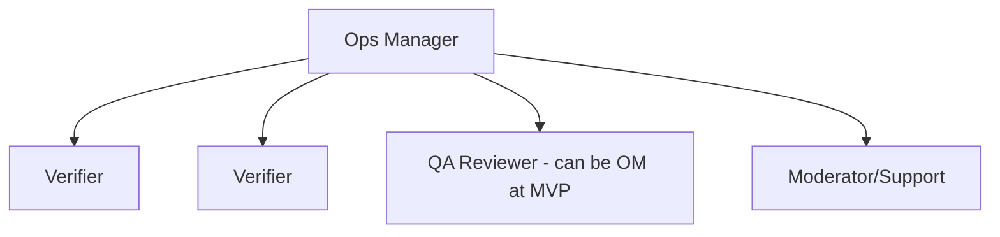

# Document 12 — Operations & Verification Playbook

**Project Codename:** HousePoint
**Document Owner:** Operations Consultant
**Status:** DRAFT · **Version:** 0.1.0 · **Last Updated:** 2026-07-18
**Parents:** *Doc 07, 03, 06*

---

## 1. Purpose
Turn the verification workflow (*Doc 07*) into a **runnable operation**: team structure, queues, SLAs, staffing model, quality assurance, escalations, and the day-to-day playbook the Operations team executes. This is a growth-critical document — verification throughput is the platform's growth ceiling (*Doc 02 §10*).

## 2. Scope
**In:** ops org & roles, queue mechanics, assignment, SLA targets & management, capacity/staffing model, verification SOP, QA/audit sampling, escalation, fraud handling ops, owner-comms ops, ops metrics & dashboards.
**Out:** the state machine itself (*Doc 07*), tooling UI (*Doc 18*).

## 3. Dependencies
Verification workflow (*Doc 07*), roles (*Doc 03*), SLA/queue tables (*Doc 08*).

## 4. Success Criteria
An ops model that meets verification SLAs at launch scale, maintains decision quality (low post-approval complaints), and scales predictably with supply.

---

## 5. Operations Org (MVP)

| Role | Responsibility |
|---|---|
| **Verifier** | Execute cases (docs+ID+call), record checklist, decide |
| **Ops Manager** | Queue health, SLA, reassignment, escalations, appeals, QA sampling |
| **QA Reviewer** | Sample-audit decisions for quality (may be OM at MVP) |
| **Moderator/Support** | Reports, disputes, user support |

## 6. Queue Mechanics
- Single **verification queue** (single city MVP) ordered by **priority then age** (FIFO within priority).
- **Priority factors:** SLA-at-risk, fraud/duplicate flags, re-verification, VIP/owner tier (future).
- **Claim model:** verifier pulls next unclaimed (or is auto-assigned) → `CaseClaimed` starts SLA clock (*Doc 07 §7*).
- **WIP limit** per verifier to prevent hoarding/aging.
- Aging & SLA-breach items float to top + alert Ops Manager.

## 7. SLA Targets (initial — tune post-launch)
> Numeric proposal; finalize with launch-city staffing (OQ-1a).

| Stage | Target (business hours) | Escalation |
|---|---|---|
| Submitted → Claimed | ≤ 4h | Alert OM if breached |
| Claimed → Decided | ≤ 24h | OM reassign/expedite |
| Owner call attempts | 3 attempts / 24h window | then INFO_REQUESTED |
| Info-requested (owner) | 5 days owner clock (ops paused) | auto-close if no response |
| Appeal (Phase 2) | ≤ 48h to OM decision | — |

**Owner promise:** "Verified within 1 business day of complete submission." (marketing-safe buffer over internal target).

## 8. Capacity & Staffing Model
```
Required verifiers = ceil( daily_submissions × avg_handle_time_hours
                           / verifier_productive_hours_per_day )
```
| Input | Placeholder | Note |
|---|---|---|
| Avg handle time / case | ~15–30 min | doc review + ID + call + record |
| Productive hours / verifier / day | ~6h | breaks, calls, admin |
| Daily submissions | from supply funnel | grows with GTM (*Doc 02*) |
- Model is **linear until automation-assist** (*Doc 07 §17*) raises cases/hour.
- Buffer for peaks (weekends), no-shows, appeals.
- **Coverage window** aligned to owner-call reachability (business + evening hours).

## 9. Verification SOP (verifier day)
1. **Pull/next case** → SLA visible.
2. **Doc review:** open sensitive docs (audited access, *Doc 10*), verify legibility, name, address, forgery cues → checklist.
3. **Identity check:** match ID to ownership doc holder.
4. **Owner call:** script — confirm identity, property, price/rent, intent, availability, consent to publish; note responsiveness.
5. **Cross-checks:** duplicate cluster? fraud signals? photos match?
6. **Decision:** Approve / Reject(reason code) / Request-info. Mandatory reason on reject.
7. **Record & submit** → event fires (*Doc 07*).
> Conflict of interest? Self-declare → reassign (BR-03.2). Never decide.

### 8-point call script (owner call)
1 Identity confirm · 2 Property/address confirm · 3 Ownership confirm · 4 Price/rent confirm · 5 Availability · 6 Intent (sale/rent) · 7 Consent to publish & contact policy · 8 Answer owner questions.

## 10. Quality Assurance
- **QA sampling:** random % of approvals + all rejections above a threshold re-reviewed by QA/OM.
- **Decision-quality metric:** post-approval complaint/report rate per verifier (*Doc 07 §14*).
- **Calibration sessions:** periodic to align verifier judgment (reduce variance).
- **Reason-code audits:** ensure correct, consistent rejection reasons (feeds appeals fairness).

## 11. Escalation & Fraud Handling
| Trigger | Path |
|---|---|
| Suspected forgery / fraud | Flag → OM/Moderator → possible blocklist (*Doc 08*) + reject `FRAUD_SUSPECTED` |
| Duplicate ownership dispute | OM adjudicates; may require additional proof; both held if unresolved |
| Repeat offender | Blocklist phone/ID/IP; user suspend/ban (*Doc 03*) |
| SLA breach spike | OM adds capacity / reprioritizes; root-cause |
| Legal/threatening report | Escalate to Admin/Legal (*Doc 22*) |

## 12. Reports & Moderation Ops
- Report queue (fake/duplicate/abuse) triaged by Moderator; can **unpublish** pending review, warn/suspend/ban, or dismiss — all audited.
- Reported live listing that fails re-check → unpublish + owner notice.

## 13. Ops Dashboards & Metrics
| Metric | Target/Use |
|---|---|
| Queue depth & oldest-age | Staffing signal |
| SLA compliance % (per stage) | Health |
| Median / p90 turnaround | Owner experience |
| Approval vs rejection rate | Filter calibration |
| Rejection reason distribution | Product/supply insight |
| Owner-unreachable rate | Comms/process fix |
| Duplicate catch rate | Trust efficacy |
| Post-approval complaint rate | Decision quality |
| Verifier throughput (cases/day) | Capacity model input |
| Appeal overturn rate | Fairness/quality |
Dashboards in Admin (*Doc 18*), data from events (*Doc 15*).

## 14. Business Rules
- **BR-12.1** Every decision auditable with actor+reason (*Doc 07 BR-07.2*).
- **BR-12.2** Verifiers never handle own/related properties.
- **BR-12.3** Owner promised SLA is externally communicated conservatively.
- **BR-12.4** Sensitive-doc access only during an assigned active case; audited.
- **BR-12.5** No case sits in limbo — every path is time-boxed to a terminal/owner-action state.

## 15. Edge Cases
| Case | Handling |
|---|---|
| Surge of submissions (campaign) | Temporary priority reshuffle + overtime/contractors |
| Verifier absent mid-case | Auto-reassign after WIP timeout |
| Owner only reachable off-hours | Extend coverage window / schedule callback |
| Ambiguous document legality | Escalate to OM/Legal, request clarifying doc |
| Mass fraudulent submissions | Rate-limit + blocklist + fraud review (*Doc 07/10*) |

## 16. Assumptions
- MVP single-city, single queue, small team.
- Human-only decisions at MVP; automation-assist later.

## 17. Risks
| Risk | Mitigation |
|---|---|
| Throughput bottleneck (Doc 01 R-1) | Capacity model, WIP, automation roadmap |
| Verifier judgment variance | QA sampling + calibration |
| Burnout/turnover | WIP limits, reasonable SLA, tooling |
| Fraud sophistication | Layered checks + escalation + reporting |

## 18. Future Improvements
- Automation-assist (OCR, image forensics, ML dedup) to raise cases/hour (*Doc 07 §17*).
- Field-agent network for physical-visit tier (future).
- Multi-queue by region/type at national scale.
- Verifier performance gamification + incentives.

## 19. Open Questions
| ID | Question | Owner |
|---|---|---|
| OQ-12.1 | Final numeric SLA targets & coverage hours (launch city). | Ops |
| OQ-12.2 | In-house vs. outsourced verifiers at launch. | Ops/Business |
| OQ-12.3 | Required doc set per type in launch city (with Legal, ties OQ-07.1). | Ops/Legal |

## 20. Related Documents
Parents: *Doc 07, 03, 06*. Related: *Doc 15 (metrics), 18 (tooling), 22 (legal escalation)*. Next: *Doc 13*.

## 21. Revision History
| Version | Date | Author | Change |
|---|---|---|---|
| 0.1.0 | 2026-07-18 | Ops Consultant | Initial draft |

---
*End of Document 12.*
