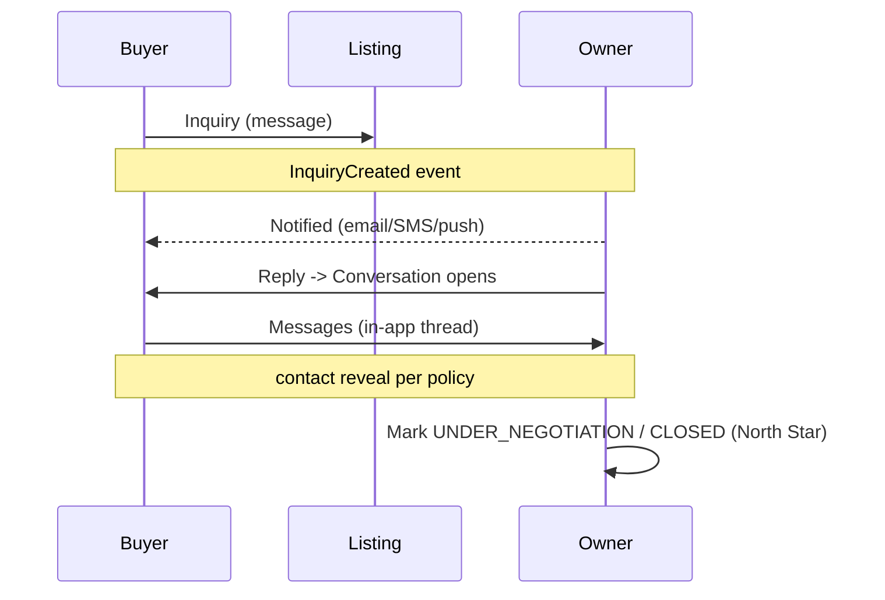

# Document 14 — Messaging & Buyer↔Owner Communication

**Project Codename:** HousePoint
**Document Owner:** Product / Architect
**Status:** DRAFT · **Version:** 0.1.0 · **Last Updated:** 2026-07-18
**Parents:** *Doc 03, 04, 07*

---

## 1. Purpose
Define how buyers and owners **communicate on-platform** (inquiries → conversations → messages) and how **transactional notifications** (email/SMS/push) are delivered. On-platform communication protects owner contact from scraping (*Doc 10 §10*), captures the lead relationship, and feeds the North Star (transactions).

## 2. Scope
**In:** inquiry flow, conversation/messaging model, contact-reveal policy, notification system (channels, templates, preferences), abuse controls, transaction milestone signals.
**Out:** realtime infra deep-dive (future), verification comms content (*Doc 07/12* reference templates here).

## 3. Dependencies
Engagement aggregates (*Doc 04*), roles (*Doc 03*), events (*Doc 04 §9*), security/anti-scraping (*Doc 10*).

## 4. Success Criteria
Buyers reach owners directly-but-safely on-platform; owners get quality, spam-controlled leads; every step notified reliably; contact details protected.

---

## 5. Engagement Flow

## 6. Inquiry Model
- Buyer (contact-verified, *Doc 03*) submits inquiry on a listing → `Inquiry(NEW)` + `InquiryCreated` event → owner notified.
- Owner replies → **Conversation** opens (thread). Inquiry → `RESPONDED`.
- Rate-limited (*Doc 10*): max inquiries/day, anti-spam scoring.
- Buyer cannot inquire on own listing (*Doc 03/04*).

## 7. Messaging Model
- **Conversation** per (listing, buyer, owner); **Messages** are participant-only (*Doc 08*).
- MVP: near-real-time via polling/short-poll + push notifications. **Phase 2: WebSocket** for true realtime (*Doc 05 future*).
- Read receipts, timestamps; message length/content limits; attachments (photos) Phase 2 with same media safeguards.
- States: OPEN / FROZEN (on suspend) / CLOSED (on deal/withdraw).

## 8. Contact-Reveal Policy (anti-scraping, pro-trust)
| Stage | What's visible |
|---|---|
| Public listing page | **No raw owner phone/email** (protects from scraping/broker theft — *Doc 10 §10*) |
| After buyer inquiry (verified) | In-app messaging enabled |
| Owner opts to share number | Phone revealed to that buyer, rate-limited, logged |
- Configurable: some markets prefer instant number reveal to verified buyers; default is **messaging-first, reveal-on-consent**. (OQ)
- All reveals audited; abuse → suspend.

## 9. Notification System
### 9.1 Channels & routing
| Channel | Use | Provider (ACL, *Doc 04*) |
|---|---|---|
| Email | Transactional (verification, inquiries, digests) | Email provider |
| SMS | Time-critical (OTP, verified, new inquiry) | SMS provider |
| Push | Mobile app (messages, alerts) | FCM/APNs |
- Async via **NotificationRequest** worker (*Doc 08*); retries + DLQ (*Doc 05*).
- **Idempotent** (no duplicate sends on event replay).

### 9.2 Template catalog (owned here; referenced by Doc 07/12/13)
| Key | Trigger | Channels |
|---|---|---|
| `owner.submission_received` | PropertySubmitted | email/SMS/push |
| `owner.info_requested` | InfoRequested | all |
| `owner.verified_published` | PropertyVerified | all |
| `owner.rejected` | PropertyRejected | email/SMS |
| `owner.new_inquiry` | InquiryCreated | all |
| `buyer.inquiry_sent` | InquiryCreated | email/push |
| `chat.new_message` | MessageSent | push/email(digest) |
| `buyer.saved_search_match` | SavedSearch match | email/push |
| `auth.otp` | OTP | SMS/email |
| `security.new_device` | login anomaly | email |

### 9.3 Preferences
- Per-user, per-channel, per-category opt-in/out (`notification_prefs`, *Doc 08*); transactional-critical (OTP, verification, security) non-optional.
- Digest option for high-frequency (messages, matches).

## 10. Transaction Milestone Signals (North Star)
- Owner can mark listing `UNDER_NEGOTIATION` and `CLOSED` (reason: sold/rented/withdrawn).
- Optional lightweight confirmation ("Did you find your buyer on HousePoint?") → counts toward **Verified Transactions Facilitated** (*Doc 01*). Phase 2–3 formalizes.

## 11. Abuse & Safety
- Spam/scam detection in messages (keywords, links, velocity); block/report in thread.
- Report from conversation → Moderator queue (*Doc 12*).
- Freeze threads on user suspend/ban (*Doc 03*).
- No sharing of sensitive docs via chat.

## 12. Business Rules
- **BR-14.1** Owner contact not exposed in public/indexable content (*Doc 10/11*).
- **BR-14.2** Only participants access a conversation (moderation-on-case exception, audited).
- **BR-14.3** Transactional-critical notifications cannot be disabled.
- **BR-14.4** Notifications idempotent per (event, channel, user).
- **BR-14.5** Suspend/ban freezes threads and inquiries.

## 13. Edge Cases
| Case | Handling |
|---|---|
| Owner unresponsive to inquiries | Nudge; show responsiveness; buyer can inquire others |
| Buyer harassment | Report → moderate → suspend; freeze thread |
| Duplicate inquiries same buyer/listing | Collapse into one conversation |
| Listing closed mid-conversation | Thread stays for history; marked closed |
| Notification provider outage | Retry + DLQ; fallback channel for critical |

## 14. Assumptions
- MVP messaging is near-real-time (poll+push); WebSocket later.
- Email/SMS providers behind ACLs (swappable).

## 15. Risks
| Risk | Mitigation |
|---|---|
| Contact scraping / lead theft | Reveal policy + gating + audit (*Doc 10*) |
| Notification spam fatigue | Preferences + digests + relevance |
| Off-platform leakage (deal done off-platform) | On-platform value + milestone prompts; not enforced heavily at MVP |

## 16. Future Improvements
- WebSocket realtime + typing/presence.
- In-chat scheduling of visits, offers, doc-free structured steps.
- WhatsApp/other channel integration.
- AI reply assist / spam filtering.

## 17. Open Questions
| ID | Question | Owner |
|---|---|---|
| OQ-14.1 | Default contact policy: messaging-first vs instant number reveal (launch-city norms). | Product |
| OQ-14.2 | Is in-app chat in MVP, or inquiry+notify only at launch (ties OQ-06.1)? | Product |

## 18. Related Documents
Parents: *Doc 03, 04, 07*. Related: *Doc 10 (anti-scraping), 12 (comms ops), 13 (alerts), 15 (events)*. Next: *Doc 15*.

## 19. Revision History
| Version | Date | Author | Change |
|---|---|---|---|
| 0.1.0 | 2026-07-18 | Product/Architect | Initial draft |

---
*End of Document 14.*
