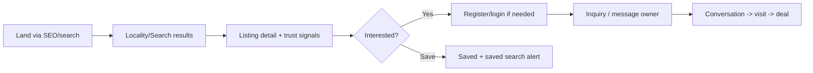
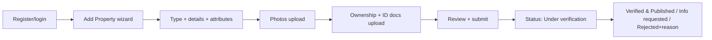

# Document 16 — Web Application UX Spec

**Project Codename:** HousePoint
**Document Owner:** UX Designer
**Status:** DRAFT · **Version:** 0.1.0 · **Last Updated:** 2026-07-18
**Parents:** *Doc 03, 06, 09, 11*

---

## 1. Purpose
Specify the **web experience** (Next.js + Tailwind + Shadcn) for guests, buyers, and owners: information architecture, key screens, user journeys, component system, accessibility, and how trust is surfaced everywhere. Mobile-first, SEO-first, clean UX (*Doc 01 pillars*).

## 2. Scope
**In:** IA/sitemap, primary journeys, screen specs (key flows), design system/components, trust UI, accessibility, responsive/perf, states (empty/loading/error).
**Out:** admin UI (*Doc 18*), mobile app (*Doc 17*), visual brand (design team deliverable).

## 3. Dependencies
Roles (*Doc 03*), features (*Doc 06*), API (*Doc 09*), SEO (*Doc 11*), messaging (*Doc 14*).

## 4. Success Criteria
Buyers trust and transact easily; owners submit and manage effortlessly; every screen is accessible, fast, responsive, and reinforces "verified."

---

## 5. Information Architecture
```
Public: Home · City/Locality landings · Search · Listing detail · How verification works · Auth
Buyer (auth): Saved · Inquiries · Conversations · Saved searches · Profile
Owner (auth): Dashboard · Add property (wizard) · My properties · Inquiries · Conversations · Profile
```
Mirrors URL taxonomy (*Doc 11 §6*).

## 6. Primary User Journeys
### 6.1 Buyer discovery → inquiry

### 6.2 Owner submit → published


## 7. Key Screens (specs)

### 7.1 Home
- Value prop ("Every listing verified"), search bar (locality/type/intent), featured verified localities, trust explainer, CTA (search / list your property). SSR, SEO-optimized.

### 7.2 Search results
- Filters (type, intent, price, bedrooms, area, locality); sort (freshness default); result cards; map toggle (Phase 2); pagination (infinite scroll, cursor).
- **Card:** photo, price, title, key attrs, locality, **Verified badge**, verified date, save.
- States: loading skeletons, empty ("no results, broaden filters / nearby"), error.

### 7.3 Listing detail (conversion-critical)
- Gallery, price, attributes (type-specific), description, locality/map, **prominent trust panel** (verified date, checks performed, "how we verified"), availability.
- **Actions:** Inquire / Message owner (gated login), Save, Report, Share.
- **No raw owner contact** (reveal on inquiry, *Doc 10/14*).
- JSON-LD + breadcrumbs (*Doc 11*).

### 7.4 Add Property wizard (owner)
- Steps: Type & intent → Location → Details/attributes (type-specific, config-driven) → Photos → **Documents (ownership + ID)** with privacy reassurance → Review → Submit.
- Autosave draft; validation per step; upload progress/retry; clear "why we need documents" trust copy.
- Post-submit: status tracker screen (submitted → verifying → decision) mirroring *Doc 07* states.

### 7.5 Owner dashboard
- Properties list with status chips (Draft/Verifying/Published/Rejected/Closed), inquiries count, quick actions (edit, availability, mark closed, resubmit).
- Rejection shows reason + fix CTA (*Doc 07*).

### 7.6 Inquiries & Conversations
- Thread list; message view (*Doc 14*); contact reveal control; report/block.

### 7.7 Auth
- Register (email/phone), OTP verify, login, forgot/reset. Minimal friction; social login future.

## 8. Trust UX (differentiator, everywhere)
| Surface | Trust element |
|---|---|
| Cards | Verified badge + date |
| Listing detail | Trust panel: what was checked (docs, ID, owner call), verified date |
| Home / explainer | "How verification works" page |
| Owner flow | Reassurance on document privacy/security |
| Search | "All listings verified" reinforcement |
> Verification depth is **visible & auditable** to counter copycats (*Doc 02 §12*).

## 9. Design System (Shadcn + Tailwind)
- Tokenized theme (color, spacing, radius, typography); light/dark ready.
- Component library: Button, Input, Select, Combobox, Card, Badge (Verified variant), Dialog, Drawer (mobile filters), Tabs, Toast, Skeleton, Stepper (wizard), Gallery, MapEmbed, Chip/StatusPill, Pagination/InfiniteScroll, EmptyState, FormField (RHF + zod).
- **Reusable across web** (and design-parity with mobile, *Doc 17*).
- Forms: React Hook Form + Zod schemas mirroring API validation (*Doc 09*).

## 10. States & Feedback
Every data surface defines: **loading (skeleton), empty, error (retry), success**. Optimistic UI where safe (save, message) with rollback on failure.

## 11. Accessibility (WCAG 2.1 AA)
- Semantic HTML, keyboard nav, focus management (dialogs/wizard), ARIA where needed, color contrast, alt text, form labels/errors announced, reduced-motion respect, target sizes (mobile). A11y checks in CI (*Doc 21*).

## 12. Responsive & Performance
- **Mobile-first** breakpoints; touch targets; sticky actions on mobile listing detail.
- Perf budgets (*Doc 11 §9*): LCP<2.5s, INP<200ms, CLS<0.1; `next/image`, code-split, minimal public-page JS.

## 13. Business Rules (UX)
- **BR-16.1** Owner contact never shown pre-inquiry.
- **BR-16.2** Verified badge only on VERIFIED+PUBLISHED (*Doc 07/11*).
- **BR-16.3** Actions the user lacks permission for are hidden (server still enforces, *Doc 10*).
- **BR-16.4** Rejection always shows human-readable reason + next step.

## 14. Edge Cases
| Case | UX |
|---|---|
| Upload fails mid-wizard | Retry per-file, keep draft |
| Listing closed while viewing | Show "no longer available" + similar listings |
| Buyer not logged in on inquiry | Inline auth, return to action |
| Slow network | Skeletons, progressive load, offline notice |

## 15. Assumptions
- One language at launch (D-1); i18n-ready copy keys.
- Design visuals delivered by brand/design team using this spec.

## 16. Risks
| Risk | Mitigation |
|---|---|
| Verification friction scares owners | Trust copy, progress, autosave, clear value |
| Trust signals ignored | Prominent, consistent placement + explainer |
| Perf regressions hurt SEO | CI perf gates |

## 17. Future Improvements
- Map-first search, saved-search management UX, comparison view, virtual tours, richer localization, social login.

## 18. Open Questions
| ID | Question | Owner |
|---|---|---|
| OQ-16.1 | Instant contact reveal vs messaging-first UX (ties OQ-14.1). | Product/UX |
| OQ-16.2 | MVP includes map view or Phase 2 only? | Product |

## 19. Related Documents
Parents: *Doc 03, 06, 09, 11*. Related: *Doc 14 (messaging), 17 (mobile parity), 21 (a11y tests)*. Next: *Doc 17*.

## 20. Revision History
| Version | Date | Author | Change |
|---|---|---|---|
| 0.1.0 | 2026-07-18 | UX Designer | Initial draft |

---
*End of Document 16.*
