# Document 19 — Non-Functional Requirements & Phased Roadmap

**Project Codename:** HousePoint
**Document Owner:** Architect / Product
**Status:** DRAFT · **Version:** 0.1.0 · **Last Updated:** 2026-07-18
**Parents:** all documents

---

## 1. Purpose
Consolidate **non-functional requirements (NFRs)** — performance, scalability, availability, security, accessibility, observability, etc. — and translate the entire documentation suite into an **executable phased roadmap** with epics per phase and exit criteria. This is the delivery contract.

## 2. Scope
**In:** NFR targets per quality attribute, SLOs, capacity assumptions, phased epic roadmap (0–4), MVP cut line, dependencies/sequencing, launch readiness checklist.
**Out:** detailed sprint planning (delivery team), infra provisioning (*Doc 20*).

## 3. Dependencies
Synthesizes *Doc 01–18*.

## 4. Success Criteria
Clear, measurable NFRs and a phase plan that launches the MVP fast without architectural rewrites (*Doc 01 §11*).

---

## 5. Non-Functional Requirements

### 5.1 Performance
| Metric | Target |
|---|---|
| Public listing page LCP (mobile) | < 2.5s |
| INP | < 200ms |
| CLS | < 0.1 |
| Search API p95 (cached/cold) | < 300ms / < 800ms |
| Write API p95 (submit) | < 1s (excl. upload) |
| Index freshness after publish | < few seconds |

### 5.2 Scalability
- Stateless API + workers **horizontally scalable** (*Doc 05*).
- Read-replica + caching for read-heavy SEO/browse.
- Read-model isolation → search engine swap without rewrite (ADR-003).
- Data model shardable by region; partition-ready hot tables (*Doc 08*).
- Target: single-city MVP → national without re-architecture.

### 5.3 Availability & Reliability
| Aspect | Target |
|---|---|
| Public read availability SLO | 99.9% |
| API availability SLO | 99.5%+ (MVP) → 99.9% |
| Event delivery | at-least-once, outbox + DLQ, idempotent (*Doc 05*) |
| RPO / RTO | RPO ≤ 15 min (backups/replica), RTO ≤ few hours (MVP) |
| Graceful degradation | search/notifications degrade without blocking core |

### 5.4 Security & Privacy
- All controls in *Doc 10*; PII/doc protection, audit, RBAC, rate limiting. Compliance per *Doc 22*.

### 5.5 Accessibility
- WCAG 2.1 AA (web *Doc 16*, mobile *Doc 17*), enforced in CI (*Doc 21*).

### 5.6 Observability
- Structured logs w/ correlation IDs, metrics (RED/USE), traces, dashboards, alerting (*Doc 20*). Every domain event auditable.

### 5.7 Maintainability
- Modular monolith with enforced boundaries (*Doc 05*), OpenAPI contract (*Doc 09*), typed SDKs, tests (*Doc 21*), docs-as-source-of-truth (this suite).

### 5.8 Compliance & Data
- Data residency, retention, consent, erasure (*Doc 22*); analytics PII-free (*Doc 15*).

### 5.9 Internationalization
- i18n-ready (copy keys, locale, hreflang) even though single language at launch (D-1).

### 5.10 Cost
- Cost-aware: CDN/ISR for reads, direct-S3 uploads, right-sized infra, autoscale (*Doc 20*).

## 6. Phased Roadmap

```mermaid
gantt
    title HousePoint Delivery Phases
    dateFormat X
    axisFormat %s
    section P0 Foundations
    Auth/RBAC/Domain/CI-CD/Event bus        :0, 1
    section P1 MVP Loop
    Submit-Verify-Publish-Inquiry (1 city)  :1, 3
    section P2 Trust & Scale
    Dedup/Fraud/Search svc/Saved/Mobile     :3, 5
    section P3 Marketplace OS
    Txn milestones/B2B/Partners             :5, 7
    section P4 National
    Multi-region/Localization               :7, 9
```

### Phase 0 — Foundations
Epics: IAM (auth, JWT, RBAC), domain module scaffolding (*Doc 04*), event bus + outbox (*Doc 05*), CI/CD + environments (*Doc 20*), OpenAPI baseline (*Doc 09*), observability baseline, one vertical slice.
**Exit:** auth works, RBAC enforced, event pipeline proven, deploy pipeline green.

### Phase 1 — MVP Loop (the core bet, one city)
Epics (Must, *Doc 06 §7*): Property submission (+media+docs), Verification console & workflow (*Doc 07/18*), Publication + trust signals, Discovery (search/filter, MySQL), Inquiry + basic messaging, Notifications (transactional), SEO (SSR/ISR + JSON-LD + sitemaps), Admin (console, config, moderation basics), Reports + basic dedup surfacing, Ops playbook live (*Doc 12*).
**Exit:** a property goes **submit → verify → public → inquiry** end-to-end in the launch city; SLAs met; SEO pages indexable.

### Phase 2 — Trust & Scale
Epics: Duplicate engine + fraud signals + trust score, dedicated search (Meili/OpenSearch), saved searches + alerts, map/geo, **mobile app** (*Doc 17*), appeals (*Doc 07*), analytics dashboards (*Doc 15*), messaging realtime.
**Exit:** duplicate/fraud minimization live; mobile launched; search scaled; retention loops active.

### Phase 3 — Marketplace OS
Epics: transaction milestones/rails, financing/insurance partners, B2B verified-data API + webhooks, automation-assist for verification (OCR/forensics/ML).
**Exit:** transactions tracked to North Star directly; first partner integration.

### Phase 4 — National Expansion
Epics: multi-region ops & queues, localization/hreflang, regional sharding, city-launch playbook automation.
**Exit:** 2nd+ city live using repeatable playbook; sustained organic growth.

## 7. Cross-Phase Dependencies (sequencing)
| Must exist before | Because |
|---|---|
| P0 event bus/outbox → P1 publish/index/notify | event-driven workflows depend on it |
| P1 API/read-model → P2 search swap | read-model isolation enables swap |
| P1 verification data → P3 automation-assist | ML needs labeled decisions |
| P1 single-city success → P4 expansion | prove flywheel first (*Doc 02*) |

## 8. Launch Readiness Checklist (P1 → live)
- [ ] Verify-before-publish enforced & tested (I-2, *Doc 07/21*)
- [ ] Sensitive-doc protection + audit verified (*Doc 10*)
- [ ] SLAs & ops staffing ready (*Doc 12*)
- [ ] SEO indexable + sitemaps + CWV budgets (*Doc 11*)
- [ ] Security review + rate limits + backups/DR (*Doc 10/20*)
- [ ] Analytics/North Star instrumented (*Doc 15*)
- [ ] Accessibility AA checks pass (*Doc 16/21*)
- [ ] Legal/compliance sign-off for launch city (*Doc 22*)
- [ ] Rollback/runbooks ready (*Doc 20*)

## 9. Assumptions
- Phasing depth adjustable, but boundaries/contracts fixed to avoid rewrites.
- Single-city MVP validates the model before scale spend.

## 10. Risks
| Risk | Mitigation |
|---|---|
| Scope creep past MVP cut line | §6/§8 as contract; roadmap governance |
| Verification throughput ceiling | P3 automation-assist; capacity model (*Doc 12*) |
| Search rewrite pain | Read-model isolation (ADR-003) |
| Cold-start | Supply-first GTM (*Doc 02*) |

## 11. Future Improvements
- SLO error budgets & reliability program.
- Chaos/resilience testing at scale.
- Multi-region active-active.

## 12. Open Questions
| ID | Question | Owner |
|---|---|---|
| OQ-19.1 | MVP scope of messaging & map (ties OQ-06.1/16.2). | Product |
| OQ-19.2 | Commercial/Land — Phase 1 or Phase 2 (owner-only supply, OQ-07)? | Product |

## 13. Related Documents
Synthesizes *Doc 01–18*. Feeds: *Doc 20 (infra), 21 (QA gates)*. Next: *Doc 20*.

## 14. Revision History
| Version | Date | Author | Change |
|---|---|---|---|
| 0.1.0 | 2026-07-18 | Architect/Product | Initial draft |

---
*End of Document 19.*
