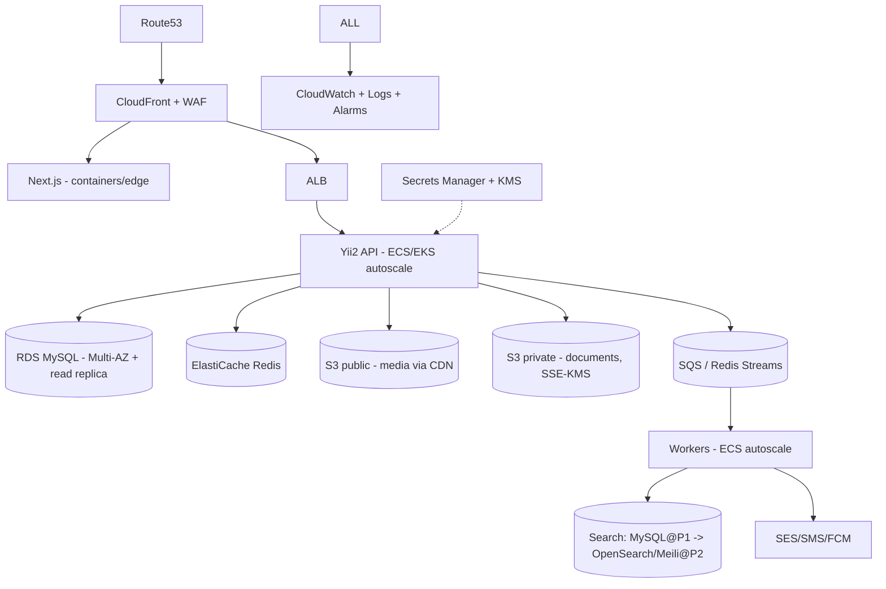
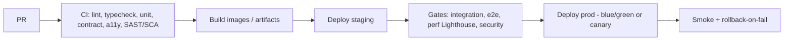

# Document 20 — DevOps, Infrastructure & Environments

**Project Codename:** HousePoint
**Document Owner:** DevOps Consultant
**Status:** DRAFT · **Version:** 0.1.0 · **Last Updated:** 2026-07-18
**Parents:** *Doc 05, 10, 19*

---

## 1. Purpose
Define **infrastructure, environments, CI/CD, observability, and operational reliability** for HousePoint on AWS: how the stack (Next.js, Yii2 API, workers, MySQL, Redis, S3) is deployed, scaled, secured, monitored, backed up, and released.

## 2. Scope
**In:** environments, cloud topology, CI/CD pipelines, secrets, observability, backups/DR, scaling, cost, incident/runbooks.
**Out:** app code (*Doc 09*), security policy detail (*Doc 10*), test strategy (*Doc 21*).

## 3. Dependencies
Architecture/topology (*Doc 05*), security controls (*Doc 10*), NFR/SLOs (*Doc 19*).

## 4. Success Criteria
Repeatable IaC deployments across dev/staging/prod; automated CI/CD with quality gates; observability + backups/DR meeting *Doc 19* SLOs.

---

## 5. Environments
| Env | Purpose | Data |
|---|---|---|
| **dev** | Integration, feature testing | Synthetic |
| **staging** | Pre-prod, UAT, perf/security gates, prod-like | Anonymized/synthetic |
| **prod** | Live | Real (PII controls, *Doc 10/22*) |
- Parity across envs via IaC; config via env vars/secrets manager (no secrets in code — global policy).

## 6. Cloud Topology (AWS)

- Containers (ECS Fargate MVP; EKS optional at scale). Stateless API/workers autoscale on CPU/queue depth.
- RDS Multi-AZ + read replica; ElastiCache Redis; S3 (public+private buckets, private SSE-KMS + block-public).
- CDN (CloudFront) for Next ISR + media; WAF for OWASP/DDoS.

## 7. CI/CD

- **Pipelines per app** (web, api, workers, admin, mobile).
- Quality gates (*Doc 21*): unit, **contract tests vs OpenAPI**, e2e, Lighthouse (CWV, *Doc 11/19*), a11y, SAST/dependency scan (*Doc 10*).
- **Deploy strategy:** blue/green or canary; DB migrations gated + backward-compatible (expand/contract).
- Mobile: CI builds, staged store rollout, OTA for JS fixes (*Doc 17*).
- IaC: Terraform (or CDK); GitOps; immutable images; versioned releases.

## 8. Secrets & Config
- **AWS Secrets Manager** + KMS; least-privilege IAM roles per service; S3/doc access via scoped roles (*Doc 10*).
- No secrets in repo/logs/images (global policy). Rotation enabled.

## 9. Observability
| Pillar | Tooling |
|---|---|
| Logs | Structured JSON + correlation/request IDs → CloudWatch/central log store |
| Metrics | RED (rate/errors/duration) + USE; queue depth, SLA breaches, verification throughput |
| Traces | Distributed tracing across API→workers |
| Dashboards | System health + ops KPIs (*Doc 12/15*) |
| Alerting | SLO burn, error spikes, queue backlog, DLQ, cert/expiry, security anomalies |
- **Golden signals** + business signals (verification queue age, publish latency).

## 10. Backups & DR
| Aspect | Policy |
|---|---|
| RDS backups | Automated daily + PITR; retention per compliance (*Doc 22*) |
| S3 | Versioning + lifecycle; cross-region replication for docs (optional) |
| RPO / RTO | RPO ≤ 15 min, RTO ≤ few hours (MVP, *Doc 19*) |
| DR drills | Periodic restore tests |
| Multi-AZ | RDS/ElastiCache Multi-AZ; multi-region future (*Doc 19 P4*) |

## 11. Scaling & Reliability
- Autoscale API/workers on CPU + **queue depth** (verification/indexing bursts).
- Read replica for read-heavy SEO/browse; cache-first (*Doc 05*).
- Backpressure + DLQ on queues; idempotent consumers (*Doc 05*).
- Graceful degradation: search/notification failures don't block core submit/verify.

## 12. Cost Management
- CDN/ISR to cut origin load; direct-to-S3 uploads (offload API); right-size tasks; autoscale down off-peak; monitor cost per env; budgets/alerts.

## 13. Incident Management & Runbooks
- Severity levels, on-call, escalation; runbooks for: queue backlog, DB failover, S3/doc-access incident, deploy rollback, provider outage (SMS/email fallback), security incident (*Doc 10/22*).
- Post-incident reviews (blameless).

## 14. Business Rules
- **BR-20.1** No secret in code/logs/images (global policy).
- **BR-20.2** Prod deploys require green gates + migration compatibility.
- **BR-20.3** Private doc bucket: block-public + SSE-KMS + scoped roles (*Doc 10*).
- **BR-20.4** DB migrations backward-compatible (expand/contract) to allow rollback.
- **BR-20.5** Every service emits structured logs with correlation IDs.

## 15. Edge Cases
| Case | Handling |
|---|---|
| Migration fails mid-deploy | Backward-compatible design + rollback + PITR |
| Queue backlog surge | Autoscale workers, alert ops, backpressure |
| Region/AZ outage | Multi-AZ failover; DR plan |
| Secret leaked | Rotate immediately, revoke, audit |
| Provider (SMS) down | Fallback channel for critical (*Doc 14*) |

## 16. Assumptions
- Single AWS region at MVP (D-1); multi-region later.
- Fargate sufficient at MVP scale.

## 17. Risks
| Risk | Mitigation |
|---|---|
| Ops complexity vs small team | Managed AWS services, IaC, automation |
| Cost overrun | Cache-heavy, autoscale, budgets |
| Data loss | Backups, PITR, replication, DR drills |
| Deploy incidents | Canary + gates + rollback |

## 18. Future Improvements
- Multi-region active-active; EKS; service mesh; progressive delivery; FinOps; chaos testing (*Doc 19*).

## 19. Open Questions
| ID | Question | Owner |
|---|---|---|
| OQ-20.1 | ECS Fargate vs EKS at launch. | DevOps |
| OQ-20.2 | Queue: SQS vs Redis Streams (ties OQ-05.1). | DevOps/Backend |
| OQ-20.3 | Cross-region doc replication needed for compliance? | DevOps/Legal |

## 20. Related Documents
Parents: *Doc 05, 10, 19*. Related: *Doc 21 (gates), 22 (retention/DR compliance)*. Next: *Doc 21*.

## 21. Revision History
| Version | Date | Author | Change |
|---|---|---|---|
| 0.1.0 | 2026-07-18 | DevOps Consultant | Initial draft |

---
*End of Document 20.*
