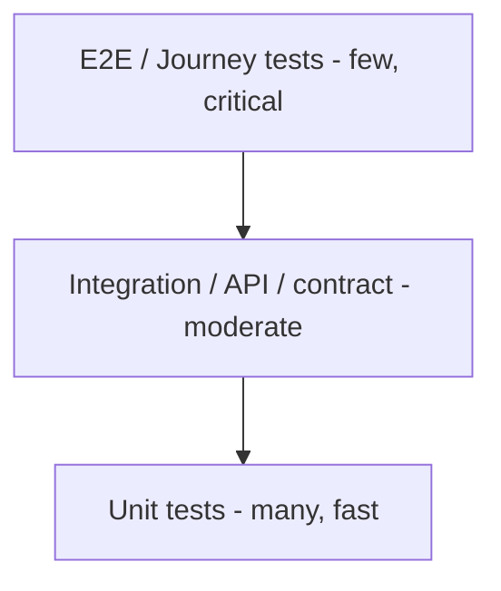

# Document 21 — QA Strategy & Test Architecture

**Project Codename:** HousePoint
**Document Owner:** QA Lead
**Status:** DRAFT · **Version:** 0.1.0 · **Last Updated:** 2026-07-18
**Parents:** *Doc 06, 07, 09, 19*

---

## 1. Purpose
Define **how quality is assured** across the platform: test strategy/pyramid, coverage of the critical verification invariants, contract testing, security/a11y/perf testing, test data, environments, and CI gates. Correctness is priority #1 (global project priorities).

## 2. Scope
**In:** test levels & pyramid, critical-path test matrix, contract/API testing, e2e, non-functional testing, test data/PII, defect management, CI gates, release sign-off.
**Out:** infra pipelines (*Doc 20*), requirement authoring (*Doc 06*).

## 3. Dependencies
Requirements/AC (*Doc 06*), verification rules & invariants (*Doc 07*), API/OpenAPI (*Doc 09*), NFRs (*Doc 19*), pipelines (*Doc 20*).

## 4. Success Criteria
The core invariant (verify-before-publish) and every critical journey are automatically tested; contract drift is caught; security/a11y/perf gated; releases sign off against acceptance criteria.

---

## 5. Test Strategy & Pyramid

| Level | Owns | Tooling (illustrative) |
|---|---|---|
| Unit | domain logic, validators, state machines | PHPUnit (Yii2), Jest/Vitest (TS) |
| Integration | API + DB + events, RBAC checks | PHPUnit + test DB, Testcontainers |
| Contract | client↔server vs OpenAPI | Schemathesis/Dredd/Pact |
| E2E | user journeys web/mobile | Playwright (web), Detox (RN) |
| Non-functional | perf, a11y, security | Lighthouse CI, axe, ZAP/SAST/SCA |

## 6. Critical-Path Test Matrix (must-pass)
| # | Scenario | Asserts | Level |
|---|---|---|---|
| T1 | Unverified property cannot be published | **I-2 / BR-07.1** (core bet) | unit+integration+e2e |
| T2 | Submit → verify(approve) → published → indexed | happy path loop | e2e |
| T3 | Reject with reason → owner notified → resubmit | *Doc 07* | integration+e2e |
| T4 | Info-requested loop pauses SLA, resumes | *Doc 07/12* | integration |
| T5 | Verifier cannot decide own property | BR-03.2 conflict | integration |
| T6 | Sensitive doc access only by assigned/authorized + **audited** | *Doc 10 §7* | integration+security |
| T7 | No PII/doc in public listing/search responses | BR-09.2/13.2 | contract+integration |
| T8 | RBAC deny-by-default per endpoint | *Doc 03/10* | integration |
| T9 | Duplicate submission clustered & surfaced | *Doc 07 §8* | integration |
| T10 | Buyer inquiry → owner notified → conversation | *Doc 14* | e2e |
| T11 | Closed/unpublished listing removed from search + 410/redirect | BR-13.3/11.2 | integration+e2e |
| T12 | Refresh-token rotation + reuse detection | *Doc 10 §5* | integration+security |
| T13 | Idempotent submit/inquiry (retry) | *Doc 09 §7* | integration |
| T14 | Event outbox delivered once-effectively (idempotent consumers) | *Doc 05* | integration |
| T15 | Re-verification triggered on material change | *Doc 07 §9* | integration |

> **T1 and T6 are release-blocking** — the trust and PII guarantees are existential.

## 7. Contract Testing
- OpenAPI (*Doc 09*) is source of truth; CI validates server responses against schema; consumer-driven contracts for web/mobile SDKs → **no drift** (BR-09/ *Doc 09 §10*).
- Event schemas (*Doc 04/15*) versioned & validated in tests (T14).

## 8. Non-Functional Testing
| Type | Approach | Gate |
|---|---|---|
| Performance (CWV) | Lighthouse CI on public pages; API load tests (k6) to p95 targets (*Doc 19*) | block on budget breach |
| Accessibility | axe automated + manual keyboard/screen-reader on key flows (*Doc 16/17*) | block AA failures |
| Security | SAST, dependency/SCA scan, DAST (ZAP) on staging, auth/RBAC tests, periodic pentest (*Doc 10/22*) | block criticals |
| Resilience | queue backlog, provider outage, DB failover drills (*Doc 20*) | staging |

## 9. Test Data & PII
- **No production PII in non-prod** (global policy); synthetic/anonymized data (*Doc 20*).
- Seed factories for properties/users/cases/localities; fixtures for each property type (RES/COMM/LAND) & each verification path.
- Fake documents for verification flow tests (never real IDs).

## 10. Environments & Execution
- Unit/contract on PR; integration on merge; e2e + non-functional on staging (*Doc 20*). Nightly full regression.
- Ephemeral preview envs per PR (optional) for e2e.

## 11. Defect Management
- Severity (S1 blocker … S4 minor); S1/S2 block release. Linked to requirement IDs (*Doc 06*) for traceability. Root-cause + regression test added for each escaped defect.

## 12. Release Sign-off
- Acceptance criteria (*Doc 06 §5.2*) verified; critical matrix (§6) green; NFR gates pass; launch-readiness checklist (*Doc 19 §8*). QA Lead sign-off.

## 13. Business Rules
- **BR-21.1** T1 (verify-before-publish) & T6 (doc/PII protection) are release-blocking.
- **BR-21.2** Every escaped bug gets a regression test.
- **BR-21.3** Contract tests must pass before deploy (*Doc 09/20*).
- **BR-21.4** No prod PII in test data/environments.

## 14. Edge Cases (test design)
Cover *Doc 07 §13* verification edge cases, upload failures, token expiry, concurrency/version conflicts, event replay, rate-limit/abuse, offline (mobile), empty/error states (*Doc 16/17*).

## 15. Assumptions
- Testable seams from modular design (*Doc 04/05*); OpenAPI available early.
- Automation-first; manual for exploratory + a11y nuance.

## 16. Risks
| Risk | Mitigation |
|---|---|
| Core invariant regressions | Blocking T1/T6, high coverage |
| Flaky e2e | stable selectors, retries, isolation |
| Contract drift | contract tests in CI |
| PII leak via tests | synthetic-only policy |

## 17. Future Improvements
- BDD generation from AC; mutation testing; visual regression; chaos testing; continuous performance monitoring.

## 18. Open Questions
| ID | Question | Owner |
|---|---|---|
| OQ-21.1 | Contract-test tool (Pact vs Schemathesis vs Dredd). | QA/Backend |
| OQ-21.2 | Pentest cadence & vendor (ties *Doc 22*). | QA/Security |

## 19. Related Documents
Parents: *Doc 06, 07, 09, 19*. Related: *Doc 10 (security), 16/17 (a11y), 20 (CI gates)*. Next: *Doc 22*.

## 20. Revision History
| Version | Date | Author | Change |
|---|---|---|---|
| 0.1.0 | 2026-07-18 | QA Lead | Initial draft |

---
*End of Document 21.*
