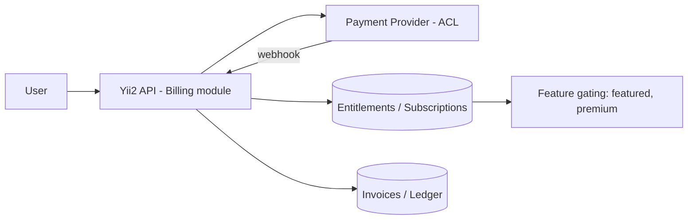

# Document 23 — Monetization & Billing

**Project Codename:** ValEstate
**Document Owner:** Product
**Status:** DRAFT (directional) · **Version:** 0.1.0 · **Last Updated:** 2026-07-18
**Parents:** *Doc 01, 02, 07, 09*

---

## 1. Purpose
Define the **monetization strategy and billing architecture** — how ValEstate earns revenue **without compromising the verification-first trust model**. Directional at MVP (launch may be free/subsidized to solve cold-start, *Doc 02 §11*), with an architecture ready to switch on paid tiers.

## 2. Scope
**In:** revenue streams, pricing philosophy, the trust guardrail, billing architecture, entitlements, phasing, metrics.
**Out:** final price points (business decision, OQ), tax/legal (*Doc 22*), accounting.

## 3. Dependencies
Business thesis (*Doc 01 §8*), GTM/cold-start (*Doc 02*), verification & featured-listing mechanics (*Doc 07/13*), API (*Doc 09*).

## 4. Success Criteria
A monetization model that funds verification cost, aligns incentives, and **never allows money to buy trust** — plus a billing architecture that plugs in cleanly when enabled.

---

## 5. Guardrail (non-negotiable, from *Doc 01 §8*)
> **Money can buy _visibility_, never _verification_.** No payment path can make an unverified property public or fake a verified badge. Every monetized surface is clearly labeled.

## 6. Revenue Streams (ranked by trust-fit)
| Stream | Fit | Phase | Notes |
|---|---|---|---|
| **Owner listing / verification fee** | High | 2 (free at launch for cold-start) | Serious owners; funds verification |
| **Featured / boosted verified listing** | High | 2 | Visibility only, labeled; never bypasses verification (*Doc 13 BR-13.4*) |
| **Buyer premium** (early access, advanced filters, instant alerts) | Med | 2–3 | Must not gate core trust value behind paywall |
| **Transaction success fee** | High | 3 | Tied to North Star; needs txn rails (*Doc 19 P3*) |
| **B2B verified-data / API** | High | 3–4 | Monetize trust asset (banks/insurers/developers) (*Doc 01 §15*) |
| **Value-added services** (legal, home loan, movers — partner referrals) | Med | 3 | Adjacent, must stay trustworthy |

## 7. Pricing Philosophy
- **Launch: free or subsidized verification** to seed supply density (*Doc 02*) — do not let pricing worsen cold-start.
- Introduce owner fees once liquidity + value proven (owners receiving genuine inquiries).
- **Value-based** (charge where clear value delivered: verification credibility, qualified leads, visibility, closed deals).
- Transparent, no dark patterns; trust brand forbids bait pricing on ourselves.

## 8. Billing Architecture

- **Billing as a bounded module** behind an **ACL** over the payment provider (*Doc 04/05*) — provider swappable.
- **Entitlements** table drives feature gating (featured slot, premium filters); checked server-side (*Doc 10*).
- Idempotent payment webhooks (*Doc 09 §7*); reconciliation ledger; refunds; dunning for subscriptions.
- Events: `PaymentSucceeded`, `SubscriptionActivated`, `FeaturedListingPurchased` → grant entitlement → (e.g.) boost ranking flag (labeled) (*Doc 13*).
- PCI: use hosted/tokenized provider fields — **never store card data** (*Doc 10/22*).

## 9. Featured Listing Mechanics (visibility, not trust)
- Owner (or later broker) buys a featured slot on an **already-verified** listing → labeled "Featured", boosted placement in eligible searches/localities.
- Caps per locality to preserve buyer experience; transparent labeling (*Doc 13 BR-13.4*).
- **Never** shown for unverified listings.

## 10. Entitlements & Feature Gating
| Entitlement | Grants |
|---|---|
| `verification.paid` | (if enabled) submission/verification credit |
| `listing.featured` | boosted, labeled placement for a period |
| `buyer.premium` | advanced filters, instant saved-search alerts, early access |
| `api.b2b` (future) | verified-data API access + rate tier |
Checked at API/UI; UI reflects, server enforces (*Doc 10*).

## 11. Metrics (feeds *Doc 15*)
- ARPU (owner/buyer), verification-fee conversion, featured attach rate, premium subscription rate/churn, revenue per verified listing, LTV:CAC, and **guardrail metric:** ensure paid features don't degrade buyer trust/NPS.

## 12. Business Rules
- **BR-23.1** No payment enables publish-without-verification or a fake badge (guardrail §5).
- **BR-23.2** All paid placements are labeled and never displace the verified-only guarantee.
- **BR-23.3** No card data stored; tokenized provider only (*Doc 10/22*).
- **BR-23.4** Entitlements enforced server-side.
- **BR-23.5** Launch pricing must not worsen cold-start (free/subsidized until liquidity).

## 13. Edge Cases
| Case | Handling |
|---|---|
| Payment succeeds, entitlement grant fails | Idempotent retry + reconciliation + support |
| Refund of featured mid-period | Prorate/revoke entitlement |
| Chargeback/fraud payment | Revoke entitlement, flag, block (*Doc 10*) |
| Featured listing gets unpublished (report/close) | Pause/refund featured; no boost on hidden listing |
| Subscription lapse | Grace + downgrade entitlements |

## 14. Assumptions
- MVP likely launches free/subsidized; billing module built (or stubbed behind ACL) for Phase 2 switch-on.
- Single currency/jurisdiction at launch (D-1).

## 15. Risks
| Risk | Mitigation |
|---|---|
| Monetization erodes trust | Guardrail §5, labeling, NPS guardrail metric |
| Pricing kills cold-start | Free/subsidized launch (*Doc 02*) |
| Payment fraud/chargebacks | Provider risk tools, entitlement revocation |
| Over-gating buyer value | Keep core trust/discovery free |

## 16. Future Improvements
- Transaction success fee once rails exist (*Doc 19 P3*).
- B2B verified-data API productization (*Doc 01 §15*).
- Dynamic featured pricing; partner marketplace (loans/legal/movers); regional pricing.

## 17. Open Questions
| ID | Question | Owner |
|---|---|---|
| OQ-23.1 | Launch: free, subsidized, or paid verification (ties OQ-02.2)? | Business |
| OQ-23.2 | Payment provider(s) for launch jurisdiction. | Business/Eng |
| OQ-23.3 | First paid feature to enable at Phase 2 (verification fee vs featured). | Product |

## 18. Related Documents
Parents: *Doc 01, 02, 07, 09*. Related: *Doc 13 (featured/ranking), 10/22 (PCI/compliance), 15 (revenue metrics)*. **End of core suite.**

## 19. Revision History
| Version | Date | Author | Change |
|---|---|---|---|
| 0.1.0 | 2026-07-18 | Product | Initial draft |

---
*End of Document 23.*
